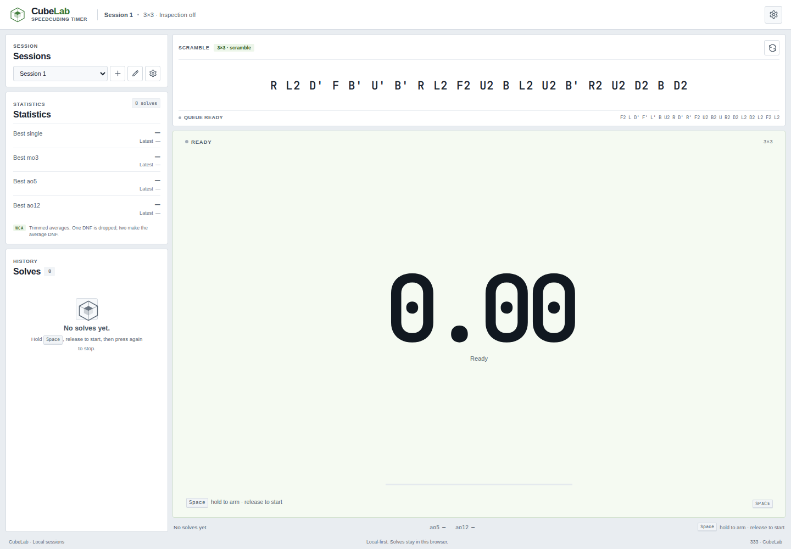
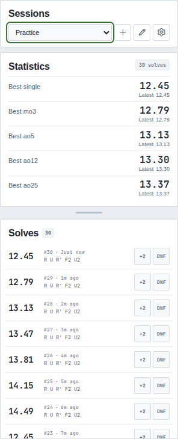
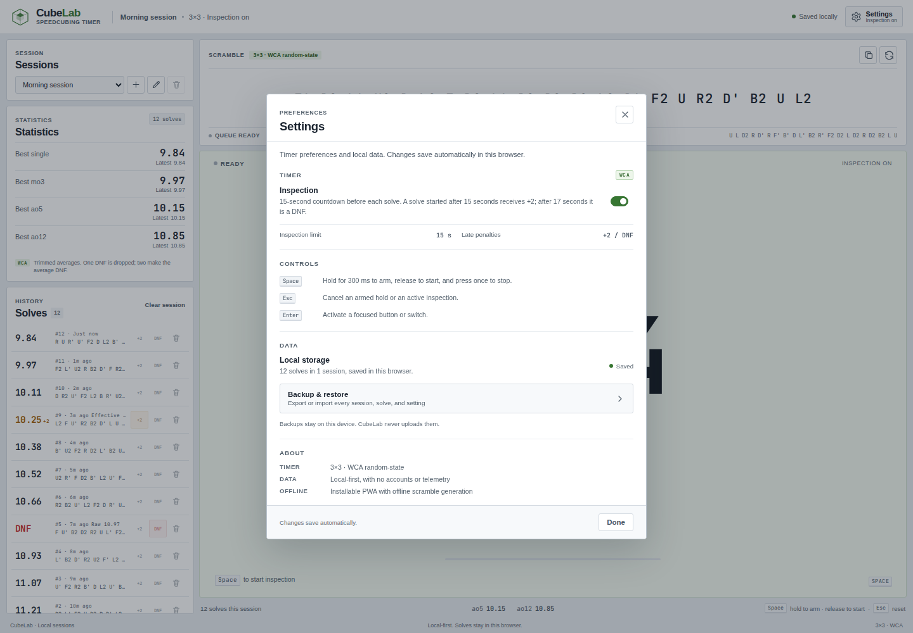
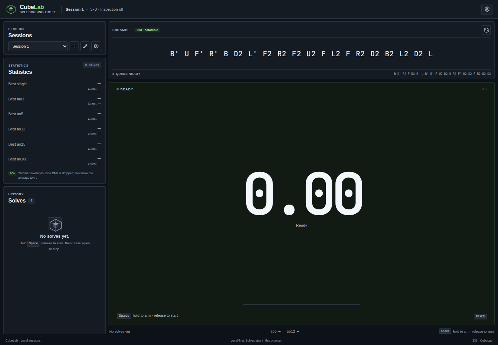
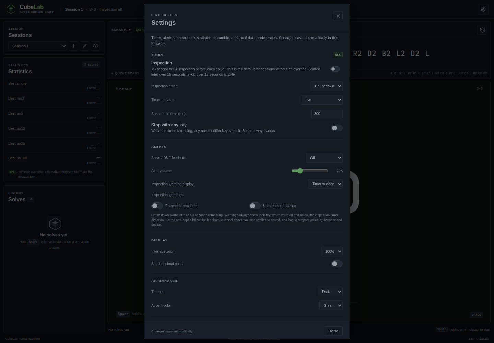
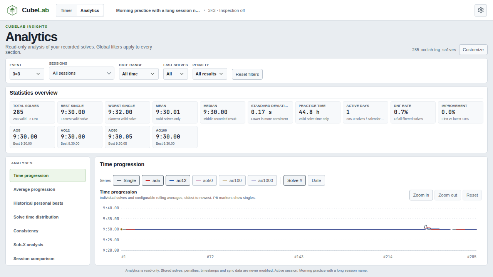
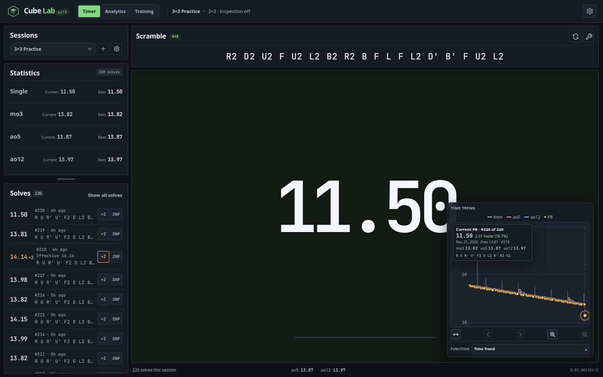
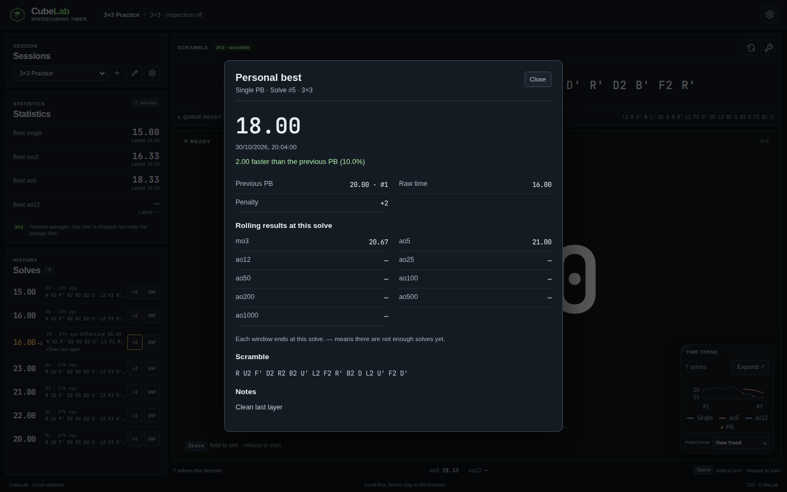
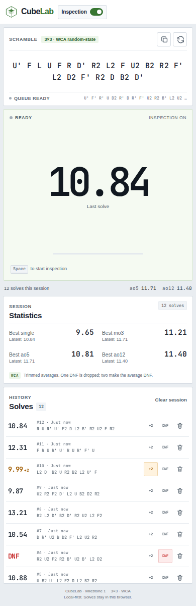
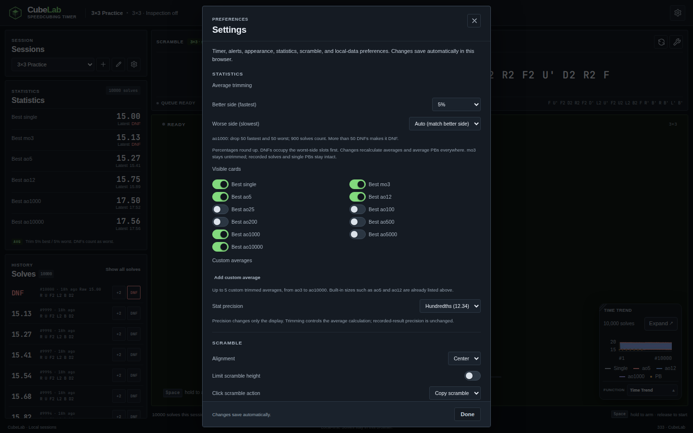

# CubeLab

**A focused, offline-first speedcubing timer with session-level event support.**

CubeLab is a focused, offline-first speedcubing timer with a flat,
csTimer-inspired interface. It combines a precise monotonic timer, official WCA
scrambles from `cubing.js` for 12 events — 3×3, 2×2, 4×4, 3×3 OH, 5×5, 6×6,
7×7, Pyraminx, Skewb, Square-1, Clock, and Megaminx — optional WCA inspection
with count-down or count-up display and
independent 8/12-second warnings, WCA-aware statistics from single through
ao10000 plus custom averages, named local sessions with per-session settings,
WCA-style competition sessions with automatic rounds, JSON backup/restore,
optional Google Drive synchronization, a dedicated analytics
dashboard, an optional Draw Scramble diagram, and a floating solve action menu
in a responsive layout built around the clock. The interface offers audited light and dark palettes plus a
system-following theme. See [`STATUS.md`](STATUS.md) for current verification
and [`ROADMAP.md`](ROADMAP.md) for the retained follow-ups.



The header switches between Timer, the read-only Analytics dashboard and
Training. Training shares the manual timer interactions while keeping its
attempts, calibration and practice visits separate from ordinary solves.
Opening Analytics never changes stored solves. A small uppercase, tilted
**BETA** pill sits by the cube mark in the header, and the same inline pill
marks **Settings → Data → Google Drive backup**.

## One active tab

CubeLab opens one editable tab or window per origin in the same browser profile.
Additional tabs show **CubeLab is already open** and wait automatically until the
owner closes. Waiting tabs do not mount recovery, timing, settings or sync hooks,
and do not write session data. Backgrounding the owner does not transfer control.
Ownership uses a browser Web Lock; if coordination is unavailable or fails,
CubeLab keeps the editable app closed and offers a retry. Separate browser
profiles, browsers, devices and different origins do not share this lock.

## Features

See [FEATURES.md](FEATURES.md) for the complete current feature inventory,
including interaction rules, settings defaults, session overrides and persistence scope.

- **Monotonic timing** with a configurable hold-to-arm gesture (300 ms by
  default) and a display refreshed with browser animation frames.
- **Large-session stop feedback** captures the input time before audio/focus work.
  The live readout updates independently, and statistics, history and charts
  refresh after the final result gets a rendering opportunity. Saving and
  synchronization continue to use the current, complete solve data.
- **Official WCA scrambles** generated by `cubing.js` for the session's event
  (3×3, 2×2, 4×4, 3×3 OH, 5×5, 6×6, 7×7, Pyraminx, Skewb, Square-1, Clock, or
  Megaminx), with a prefetched next scramble and explicit loading, failure, and
  retry states.
- **MISC event** for puzzle types CubeLab does not officially support. It is
  available in every event picker with no generated scramble or 2D/3D diagram.
  Existing custom-event sessions and solves are migrated into MISC on load;
  their scramble text and csTimer provenance stay intact. Unsupported csTimer
  identifiers also import into MISC.
- **First-run onboarding** for a clean browser: start fresh with one ready empty
  session per selected event, import a csTimer backup without extra event setup,
  or restore an existing CubeLab setup through Google Drive. The optional sync
  step never blocks local use, returning users only confirm device-local display
  options. The fresh setup separates **Settings** and **Appearance** into
  ordered steps; the appearance step exposes theme, accent and custom color
  controls. A short completion summary (about two seconds, with a skip action)
  opens the timer automatically with the Main Event active. **Settings → Data → Setup assistant** reopens the
  flow non-destructively; existing users are not prompted after an update.
- **Competition sessions** created from the normal session dialog. Choose
  Practice or Competition, then an immutable round format: ao5, ao12, ao50,
  mo3, or bo3. New 6×6 and 7×7 sessions preselect mo3; every other event
  preselects ao5. Timed solves fill the open round automatically, spill into
  the next round when full, and persist as ordinary solves with round membership.
  The session list shows a format badge; Attempts groups rows under expandable
  round headers and marks incomplete rounds; Statistics lists the session's
  latest, best, and DNF rounds. Completing a round opens a summary with trimmed
  attempts, the result, and the session-best comparison. There is no manual
  new-round action. Deleting one attempt leaves an incomplete round, deleting
  all of a round's attempts removes it, and Undo restores round fields intact.
  Competition solves count normally in Analytics and PBs. Conversion to practice
  is one-way and flattens rounds; practice sessions can never become competition
  sessions, including through split.
- **Merge and split sessions** from **Session settings**. Merge one or more
  same-event sources into a destination with a counted preview; split selected
  solves or ranges into a new session that copies the source event/settings and
  is inserted next to it. Solve IDs and fields are preserved, and durable
  ownership records keep moved solves correct through reloads, backups,
  cross-tab adoption, and stale cloud snapshots.
- **Draw Scramble tool** opened with the scramble panel's **Current tool**
  button. The button toggles a compact panel in the bottom-right of the timer
  area; the panel's footer **Function** dropdown selects the tool. The panel
  can be dragged by its header and resized from its bottom-right corner, with
  the resulting position and size persisted locally. A saved or released
  position that would cover the timer readout is moved to the nearest clear
  side when the stage has room. It is pointer-isolated from
  the timer, follows the live scramble and event, and shows either a
  colour-accurate 2D unfolded net for every supported N×N puzzle or the
  `cubing.js` PG3D render. The 2D net uses the standard cube colour scheme
  (U white, D yellow, F green, B blue, R red, L orange); non-cube puzzles show
  an honest "2D net is not available" message in 2D mode and render their
  correct 3D puzzle in 3D mode. The 2D/3D choice lives only in
  **Settings → Scramble**.
- **Time Trend tool** selected in the panel's **Function** menu. The compact
  chart fills the panel and keeps PB markers small. Click a PB marker (or focus
  it and press **Enter**) to open its read-only statistics: recorded time,
  previous PB and improvement, rolling results ending at that solve, raw time,
  penalty, date, scramble, and notes. The stats dialog works in both chart
  views and returns focus to the marker when closed. The chart plots recorded solve
  results and rolling averages from oldest to newest, includes slow outliers,
  leaves gaps for DNFs, and never uses negative time labels. **Expand** opens
  a responsive dialog with series and PB toggles, custom averages (ao3–ao10000),
  zoom, earlier/later controls, a range slider, a real date axis, solve details,
  and range statistics. With the pointer over either chart, two-finger up/down
  scrolling (or the mouse wheel) zooms time vertically, and left/right scrolling
  zooms solve history horizontally. **Shift + wheel** also zooms horizontally;
  a trackpad pinch zooms both axes around the pointer. Click and drag to pan.
  **Zoom axes** chooses which axes the expanded-view zoom buttons affect.
  **Fit all** resets both axes, and the compact **Fit** button does the same.
  Horizontal navigation keeps the vertical scale fixed. Expanding is
  disabled during timing; the dialog contains keyboard focus and closes with
  Escape, returning focus to **Expand**.
- **Additional floating tools** selected from the same **Function** menu:
  **Confirm Time** adds a typed solve (`12.34` or `1:02.34`) with the current
  scramble; **Statistics** summarizes the session; **Time Distribution** draws
  a local histogram; **Daily Stats** groups solves by day; **Metronome** clicks
  at a chosen interval (no BPM setting); and **Online Battle** pairs two peers
  with manual WebRTC invitation/answer codes, a room ID and password, and a
  shared-scramble race timer. No CubeLab backend is involved; codes must be
  shared manually and strict NATs may block a direct connection.

- **OLL / PLL Training** opens the **Training Hub**. It restores the saved set,
  practice type, and cases. Edit the session name and case selection as a
  draft and see statistics for the selected category. Opening the Hub or
  applying a case edit leaves practice history and saved preferences intact.
  **Begin training** saves a named session with the chosen category and a
  verified built-in algorithm for each selected case. All 57 OLL and 21 PLL
  cases work immediately without configuration. Algorithm revision tracking is
  temporarily retired: attempts are always recorded case-only, and stored
  custom algorithms, preferred revisions and historical attribution are erased
  at load while timing, setups, visits and case statistics remain. Every
  generated setup is cube-state verified.
  Execution needs one enabled case with a verified algorithm; recognition needs
  two. **Show upcoming case** in the main Settings dialog defaults on and
  controls the name and diagram for both execution modes. Recognition hides the target
  until completion and uses the fixed FR insertion or Sune. Initial recognition calibration times seven repetitions of
  the fixed precursor. Missing or due calibration is required at Begin for
  the selected set. Invalid repetitions can be retried, and cancelling returns
  to the Hub draft. Once practice starts, renewal waits for the next session.
  **Current session** shows the captured selection and offers **End session**.
  End and navigation away ask for confirmation. A nonempty session opens its
  report before returning to the Hub or selected view. The inactivity prompt
  defaults to 15 minutes and waits while the timer is armed or running.
  Reopening with unfinished practice offers a choice to continue or end; a
  pre-named-session legacy visit is end-only and is not reopened as interactive
  practice. Escape cancels a hold or inspection but never discards a running
  attempt. The readout, Statistics, Attempts, and Last Result use the active
  session, while visit-improvement comparisons use the full category history;
  attempt counts remain session-scoped.
  The sidebar
  shares Timer's Statistics rows, windowed history and resizable split.
  **Customize** in Statistics options sets the visible rows, order, and Current/Best columns
  for each category. **Raw** and **Estimated** switch the recognition timing
  series. **Detailed statistics** opens a searchable case view. Select an **Attempts** row to open the same action menu used by Timer.
  From it you can correct the result, copy the setup or attempt, open the compact
  **Attempt details** dialog, or delete the attempt. Attempt details shows the
  case, time, setup and result. **Delete attempt** takes effect
  immediately and offers **Undo** in the notification.
  The floating **Last Result** shows the previous case and allows retrying and
  marking it difficult. It docks below the timer when space is tight.
  The Hub shows recent sessions and opens the filterable Practice history.
  Reports show measured times, comparisons, estimated Recognition components
  with coverage and a keyboard-inspectable attempt chart. Historical review
  is read-only. A typed **DELETE** removes an acknowledged archived session
  and its attempts; its visit and attempt tombstones are written atomically to
  the Training sync ledger before the local removal. Deleting a saved preset
  offers Undo. Timing is manual
  with success or DNF. Training history is included in native backup files,
  which use checked gzip above the compact 10 MB form, and can be backed up or
  synchronized separately to Google Drive. Manual upload and sync share the
  Training device ID. A replace-only Training restore, native or manual Drive,
  clears stale Training tombstones, conflicts and approvals while keeping that
  device ID and preferences. The Drive dialog offers manual Training cloud
  backup and replace-only restore using separate `cubelab-training-*` files,
  plus optional merge-based Training synchronization with its own state,
  tombstones, conflict
  review and retention. Training sync aborts a stale publish and retries when
  local Training or the ledger changes during an upload; malformed partial
  ledgers block writes, and a persisted `syncing` status returns to pending or
  disabled on load. Unreadable or oversized remote Training files are skipped
  with a warning and can be deleted from the dialog. Solve Drive synchronization
  never includes or lists Training. See
  [Training behavior](docs/training/CURRENT_STATUS.md).
- **Analytics dashboard** opened from the header **Analytics** tab. Global event,
  session, date-range, latest-count, and penalty filters drive overview cards,
  time and average progression, historical PBs, a clickable distribution,
  consistency and Sub-X analysis, session comparison, practice activity,
  advanced percentiles/rankings, and a filtered solve-list dialog. Charts support
  hover, keyboard inspection, zoom, pan, and reset; solve points and list rows
  open a read-only detail dialog. The Statistics overview stays at the top and a
  left analysis list (or narrow-screen dropdown) shows one analysis at a time;
  on narrow screens the filter controls collapse behind a **Filters** button
  that shows the active-filter count. Visibility and order preferences merge
  with the other global settings.
  Practice activity covers the complete filtered date range with year-aware
  labels, and the Sub-X session breakdown shares a resizable split with its
  chart. Analytics is lazy loaded, calculation results are memoized, large lines
  are downsampled, and no analytics calculation runs while the timer is active.
  A subtle display version in the bottom-right footer identifies the running
  build.
- **Analytics → Algorithms** reads Training history. Filter Execution or
  Recognition by OLL/PLL and date to see case performance, measured time
  progression, practice volume and DNF rate. Open filtered Practice history
  or return to the Hub with **Start new session**.
- **CubeLab-themed dropdowns** replace native select menus in the established Timer and Analytics flows,
  including Settings, session and event pickers, Analytics filters, import and
  Drive dialogs, and tool controls. They match both themes, support arrow keys,
  Home/End, Enter, Escape, type-ahead, touch and screen readers, close on outside
  presses, return focus to the trigger, and stay inside the viewport and modal
  focus containment. Space operates a focused dropdown's own menu rather than
  starting or stopping the timer.
- **Global keyboard controls** outside text-entry fields and modal dialogs,
  plus pointer controls on the timer surface. An optional **Stop with any key**
  setting stops a running solve with a non-modifier key. Timer keys are disabled
  while the Analytics page is open.
- **Optional WCA inspection**, enabled by default for new installs, with
  automatic `+2` and DNF penalties, a count-down or count-up display, and
  independent optional warnings when the **8 or 12 seconds have elapsed** (7 or
  3 seconds remaining in count-down mode).
- **csTimer-inspired Settings dialog** with Timer, Alerts, Display, Appearance,
  Statistics, Scramble, Data, Training, a collapsed Developer options section,
  and About. It covers inspection direction and warnings, timer updates,
  Space-hold time, an optional any-key stop, visual/sound/haptic solve and DNF
  alerts with adjustable volume, a light/dark/system theme, accent presets plus
  custom accent/background/timer colors with a hold-to-preview surface, an
  optional hide-even-seconds readout, visible statistics, independent row
  metrics, custom averages, display precision, display scaling, optional
  current-session solve progress and total time, scramble presentation
  (including the Draw Scramble 2D/3D visualization), Training domain/renewal
  settings, local-data status, and backup/restore access.
  Enabled inspection warnings always pulse visually and announce a direction-aware
  label through the live region; there is no warning-text overlay. Sound and
  haptic follow the selected feedback channel. DNF feedback is slightly louder than solve
  feedback at the same volume setting.
- **Named local sessions** with create, switch, rename, reorder, and a per-session
  settings gear for event correction, inspection override, clear, and confirmed
  delete. Each session has independent solves and statistics. The session
  selector separates row selection from a drag handle; dragging or the handle's
  arrow keys reorder sessions without changing the active one. The picker is
  portalled above the page so it is never clipped by the sidebar. Order persists
  locally, is included in backups, and synchronizes across devices.
- **Configurable average trimming** in **Settings → Statistics**. Choose better
  and worse sides independently, with a 5% better-side default and **Auto** on
  the worse side. Options include 0/1 solve, 1%, 5%, 10%, 20%, and median.
  The same policy recalculates averages and average PBs in cards, quick stats,
  the trend graph, and historical PB details; stored solves and single PBs
  remain intact.
- **Session statistics**: best/latest single, mo3, ao5, ao12, ao25, ao100, ao200,
  ao500, ao1000, ao5000, and ao10000, plus up to five custom trimmed averages
  from ao3 to ao10000. All averages honor the configured trimming and DNF rules.
- **Solve history** containing the raw time, penalty, scramble, timestamp,
  optional comment, and a stable unique ID. Click a row or press <kbd>Enter</kbd>
  to open a floating action menu. Wider layouts also show inline **+2** and
  **DNF** controls; narrow layouts keep every action in the row menu to avoid
  crowding the timestamp and scramble.
- **Solve actions**: add/remove `+2`, mark/clear DNF, delete with a durable
  synchronized undo, copy the scramble, solve time, or full solve text, and add
  or edit a persisted comment.
  Session clearing and deletion live in the session settings gear. Deletion
  intent is persisted before solves disappear: **Clear Session** blocks if its
  deletion record cannot be saved, and an Undo that cannot restore the solve
  immediately keeps a local recovery record that completes after reload or
  storage recovery. Deleting a whole session persists the collection before
  publishing the removal; if that write fails, its durable deletion record is
  revoked so a later sync cannot remove a session that is still visible.
  Destructive session actions save once rather than immediately autosaving the
  same collection again. An
  Undo interrupted before its deletion revocation commits
  aborts and leaves the solve deleted; after that commit point, recovery finishes
  the restoration. If the original session was removed or changed event,
  recovery uses a clearly labelled compatible session instead of mixing events,
  and native/manual backups include the pending solve.
- **JSON backup and restore** covering every session, solve, setting and the
  available Training history. Imports are validated and replace local data only
  after explicit confirmation; large native backups use checked gzip.
- **Developer options** in Settings are collapsed by default. **Danger Zone**
  provides three typed-confirmation actions: **Reset All Solve Data** removes
  every solve while keeping session names, event assignments, preferences,
  and application settings; **Delete All Sessions** removes every session and
  solve, then creates one empty active **Session 1** while preserving settings. These two record
  durable deletion metadata for synchronization. **Reset All Site Data** is the
  full local restart: it disables synchronization, blocks Drive access, clears
  CubeLab's localStorage/sessionStorage keys, CubeLab IndexedDB databases,
  CubeLab application caches, the scoped service worker, readable CubeLab
  cookies and locally held Google authorization, then reloads into first-visit
  onboarding. It never deletes or
  overwrites Google Drive files and does not upload an empty state; reconnect
  explicitly to use Drive again. Existing Google Drive snapshots are not deleted
  by any of these actions. A reset that cannot finish (for example, a blocked
  IndexedDB connection) reports the partial failure and offers a safe retry.
  Reset progress and failure dialogs are part of the global modal input guard,
  so timer keys cannot act behind them.
- **csTimer `.txt` / `.json` import** detects the csTimer format automatically
  and shows a concise preview table of every session name and solve count,
  including empty sessions. Sessions are appended in csTimer `rank` order, with
  the session number as the deterministic fallback and tie-breaker. Original
  names are preserved, including numeric names; conflicting names are resolved
  case-insensitively against both local and imported sessions with
  `name(1)`, `name(2)`, and so on, while existing stored sessions keep their
  names. Valid omitted `opt.scrType` metadata uses csTimer’s `333` default;
  explicit supported identifiers map to built-in events, and explicit
  unsupported identifiers import into **MISC** with no generated scramble. Missing or malformed metadata is not treated as
  a 3×3 default. Imported solves retain penalties, scrambles, comments,
  original dates, and csTimer provenance (including whether the type was
  explicit or default). Empty sessions are imported with import time as the
  fallback when their dates are missing or unusable. Invalid durations, dates
  for sessions with solves, malformed solve lists, or malformed rows reject the
  file with a session/solve error before preview or confirmation. Missing solve
  dates retain the existing session-date/current-time fallback; valid imports
  add sessions while leaving existing settings and history unchanged.
- **Optional Google Drive synchronization** using device-owned snapshots,
  field-level merging for solves, session metadata, preferences, and global
  settings, plus manual conflict review. Unsupported and legacy custom event
  IDs normalize to MISC before merge. It defers while the timer is active and
  never runs before you explicitly connect a Google account.
- **Local-first persistence** with versioned, validated browser storage and
  automatic migration from the original single-session key.
- **Installable PWA** with local timing and scramble generation available offline
  after the production service worker and assets finish caching. Drive operations
  require a network connection; offline coverage is Chromium-only in this harness.
- **Responsive, accessible UI** for desktop, tablet, and mobile, including 28 px
  touch targets, visible focus states, modal focus containment, and WCAG AA
  secondary-text contrast.

## Interface

The layout follows the familiar speedcubing-timer structure: a session switcher,
session statistics, and solve history in the left rail; the scramble above the
timer; and the clock as the dominant element. When Draw Scramble is active, its
compact diagram panel floats over the bottom-right of the timer area. It is
absolutely positioned and never participates in the readout's layout, so opening,
closing, dragging, resizing, or switching tools leaves the centered timer fixed.
The base timer and sidebar stack without overlap at short viewports. The flat light and dark themes
use neutral panels, an accent-tinted timer surface, and a solid accent available
in green, blue, violet, or amber. The theme follows **Light**, **Dark**, or
**System** in **Settings → Appearance**; the predefined text/surface and accent pairs in both palettes are
checked against WCAG AA contrast thresholds, and the stored choice is applied before
the first paint. There are no decorative gradients, glows, or background
effects. On narrow screens the timer comes first, with the session controls,
statistics, and history stacked below it. Short portrait and landscape viewports
give the timer a readable minimum height and let the workspace scroll beneath
it, so panels never paint over the readout.

The header **Settings** button opens a csTimer-inspired preferences dialog. The
dialog groups timer, alerts, display, appearance, statistics, scramble, data,
developer, and about preferences in one place, with progressive migration from
older settings records. At 320 px the Settings dialog keeps the inspection label and
its switch touch target visible, and its body scrolls independently so the Done
button stays reachable.

On desktop, drag the divider between Statistics and Solves to resize the
statistics area. Arrow keys resize a focused divider; Shift makes the step
larger, Home/End select the limits, and Enter or a double-click restores the
default split. The split is saved locally with the display preferences. The
minimum is measured from the intrinsic compact height of the header and every
enabled row, including wrapped metrics, so resizing never removes an average.
Remaining height is shared between rows; when the viewport genuinely cannot fit
both panel minimums, the Statistics content scrolls internally and Solves keeps
its floor. Narrow screens show every enabled statistic in the stacked layout
without the desktop divider. The accessible separator's percentage range and
value reflect the effective content and Solves constraints.



The desktop history rail scrolls internally rather than stretching the page.
Histories above 200 solves are windowed so only the rows
near the visible area render; spacers preserve scroll height and
`aria-setsize`/`aria-posinset` expose the full count. A **Show all solves**
control restores every row for find-in-page and full keyboard traversal. Solve
rows open a compact menu anchored
near the row; the menu stays inside the viewport on narrow screens.





The same palette and accent apply throughout the Settings dialog:



### MISC events

**MISC** is the single catch-all event for unsupported puzzle types. It appears
in every event picker but has no official scramble generator or 2D/3D
visualization; existing scramble text is retained and a neutral placeholder is
shown when the scramble is empty. Older custom-event sessions, solves and
csTimer imports are migrated to MISC on load. The former custom-event manager is
retired.

### Analytics

The Analytics tab analyzes the current solve history without modifying it. Event,
session type (All / Practice / Competition), session, date range,
latest-solve count, and penalty filters apply to every analysis. A compact
scope toolbar sits below the page title; choosing a **Custom** date range opens
a themed floating range calendar instead of extra date dropdowns. Lazy loading
shows structural skeletons rather than spinner-only text. and the statistics
overview promotes the fastest single, current rolling averages, and total volume
above a dense secondary metric grid. The dashboard shares WCA effective-time,
+2/DNF, precision, and trimming rules with the timer statistics. The overview
stays at the top; below it, a flat analysis list selects one of the remaining
analyses at a time. The **Analysis** heading stays outside the bounded tab
scroller, so switching sections never scrolls or shifts the rail. Narrow screens
replace that list with an accessible **Analysis** dropdown.



On desktop the dashboard fits the available viewport instead of scrolling the
whole page. The overview and selected analysis use bounded internal scrolling;
the selected chart flexes to the remaining height, and longer tables remain
reachable inside the analysis panel. Narrow layouts deliberately keep page
scrolling so controls and text stay readable. Increased interface zoom also
switches the workspace to page scrolling instead of clipping the analysis.

Charts remain interactive at large histories: dense lines use ordered bucket
downsampling, the filtered solve-list dialog virtualizes its rows, and both the
page and its chart code are loaded separately from the timer. Hover or keyboard
inspection shows a per-series tooltip, and histogram tooltips report the
interval, solve count, and share before drill-down. Section visibility,
order, and per-event Sub-X targets are stored in synchronized settings. Retired
Solve explorer entries in older saved layouts are ignored without invalidating
the rest of the customization. The retired width preference also remains in
stored settings for backward compatibility, but the one-analysis panel uses the
full available content width. Solve-time distribution derives its automatic
interval from the central 98% of the current filtered data; extreme values stay
counted in grouped edge intervals and remain drillable, while an explicitly
chosen interval is preserved across filter changes. Sub-X accepts direct seconds
with up to three decimals, offers event-specific presets such as Sub-15/20/30 for
3×3, and retains the per-event target in synchronized settings. Its session
breakdown keeps sticky column headings, every session row, and a keyboard-
resizable chart/table split.

Practice activity keeps totals, streaks and weekly/monthly volume for the
complete filtered range, but the heatmap renders only one bounded calendar
window at a time. **Earliest**, **Earlier**, **Later** and **Latest** navigate
the full history without allocating or laying out one cell per elapsed day;
month labels repeat the year at the start and each January, and the weekly
solve-volume axis includes the year whenever the filtered history spans multiple
years. Chart date labels stay compact for single-year histories. Relative date
presets and the current streak re-evaluate at local midnight and when the page
returns to view, even if no solve or filter changed.

The compact chart zoom group uses accessible icon buttons for zoom in, zoom out,
and reset, with disabled, hover, active, and focus states in both themes. The
existing wheel/pinch zoom, drag pan, keyboard point inspection, and touch
behavior are unchanged.

### Time Trend

The compact view scales with the tool panel, and the expanded dialog uses the
available desktop or mobile width. PB markers stay visible without dominating
the trend; all selected series share a nonnegative time scale.



Click a PB marker to inspect the result and its rolling statistics at that point:



### Mobile layout



## Controls

| Action | Input |
| --- | --- |
| Arm the timer | Hold <kbd>Space</kbd>, or press and hold the timer surface, for the configured hold time (300 ms by default) |
| Start timing | Release <kbd>Space</kbd> or the pointer; an eligible hold starts from the release timestamp even if no animation frame arrived first |
| Stop timing | Press <kbd>Space</kbd>, click, or tap once; if **Stop with any key** is enabled in **Settings → Timer**, any non-modifier key also stops the running timer |
| Cancel a hold or inspection | <kbd>Esc</kbd> |
| Regenerate the scramble | Use the regenerate button in the scramble panel |
| Show or hide the tool panel | Click the **Current tool** button above the scramble |
| Move the tool panel | Drag the panel's header handle |
| Resize the tool panel | Drag the bottom-right resize handle |
| Select the tool shown in the panel | Use the **Function** dropdown in the panel footer; the panel stays open |
| Inspect a PB | Click its marker in either chart, or focus it and press **Enter**; close the stats dialog with **Close** or **Escape** |
| Open Analytics | Use the header **Analytics** tab; it is unavailable while the timer is active |
| Filter Analytics | Use the event, session-type, session, date-range, latest-count, and penalty controls above the dashboard |
| Choose a custom Analytics date range | Pick **Custom…**, then choose the range in the floating calendar |
| Inspect an Analytics point | Point at a chart for values, or focus it and use the arrow keys; press **Enter** to open the solve details |
| Zoom or pan an Analytics chart | Scroll over the plot to zoom; drag to pan; use **Reset** to restore the full range |
| Drill down from the distribution | Click a histogram bar to open those solves in the solve-list dialog; **Clear interval filter** removes it |
| Choose an analysis | Use the analysis list on the left, or the **Analysis** dropdown on narrow screens; the Statistics overview stays above it |
| Customize Analytics | Use **Customize** to show/hide or reorder the overview and analyses; **Reset layout** restores the defaults |
| Resize the Sub-X breakdown | Drag the divider between the chart and session table, or focus it and use the arrow keys; Home/End select the limits and Enter restores the default |
| View all filtered solves | Use **View solves** in the Analytics heading; select a row to inspect its solve details |
| Zoom and pan Time Trend | Scroll ↕ for vertical zoom, ↔ (or Shift + wheel) for horizontal zoom; pinch for both; drag to pan; **Fit all** resets |
| Explore solve-time trends | Select **Function → Time Trend**, then **Expand** for series, zoom, range navigation, and solve details |
| Add a solve from a typed time | Select **Function → Confirm Time**, enter `12.34` or `1:02.34`, then **Add solve** |
| Review session statistics or distribution | Select **Function → Statistics**, **Time Distribution**, or **Daily Stats** |
| Start a metronome | Select **Function → Metronome**, set the interval in milliseconds, then **Start** |
| Race another CubeLab user | Select **Function → Online Battle**; create a room or paste an invitation, exchange the answer code, then start the shared scramble |
| Choose the Draw Scramble 2D net or 3D puzzle | Open **Settings → Scramble → Draw Scramble visualization** |
| Copy or advance the scramble | Click either side of the scramble text when that action is enabled in **Settings → Scramble** |
| Open Settings | Use the gear button in the header; it is unavailable while timing |
| Change the global inspection default | Open **Settings**, then toggle **Inspection** under **Timer** |
| Override inspection for one session | Open the session settings gear, then toggle **Inspection for this session** |
| Choose count-down or count-up inspection | Open **Settings → Timer → Inspection timer** |
| Show 8-second or 12-second warnings | Open **Settings → Alerts → Inspection warnings** |
| Tune timer updates, Space hold, scramble layout, and display scaling | Open **Settings**, then adjust **Timer**, **Display**, or **Scramble** |
| Choose solve/DNF and inspection feedback | Open **Settings → Alerts** and choose visual, sound, haptic, or a combination |
| Adjust alert volume | Open **Settings → Alerts** and move the **Alert volume** slider |
| Choose a light, dark, or system theme | Open **Settings → Appearance → Theme** |
| Change the accent color | Open **Settings → Appearance** and choose a preset or enter a custom hex color |
| Customize page/timer colors | Open **Settings → Appearance**, edit the color fields, and hold the preview surface to test timer states |
| Hide even seconds while running | Open **Settings → Display** and enable **Hide even seconds** |
| Configure Training preferences | Open **Settings → Training** for trimming, inactivity, baselines, renewal and upcoming-case display |
| Configure average trimming | Open **Settings → Statistics → Average trimming**; changes recalculate averages and average PBs |
| Show or hide statistic cards, add custom averages, and choose precision | Open **Settings → Statistics** |
| Switch session | Open the session selector, then choose a name with the pointer or arrow keys and <kbd>Enter</kbd> |
| Create a competition | Choose **New session**, set **Competition**, then pick the round format |
| Convert a competition to practice | Open the session settings gear and use **Convert to practice…** |
| Create a session | Use **New session** beside the session selector |
| Rename a session | Open the session settings gear and edit **Session name** |
| Reorder sessions | Open the session selector; drag a row's handle, or focus it and press the arrow keys. This never changes the active session |
| Close a dropdown | Click or tap outside it, or press <kbd>Esc</kbd>; focus returns to its trigger |
| Correct a session's event | Open the session settings gear and choose an event; sessions with solves require confirmation |
| Clear or delete a session | Open the session settings gear beside the select |
| Open solve actions | Click a solve row or focus it and press <kbd>Enter</kbd> |
| Add a solve comment | Open solve actions, choose **Add comment**, then **Save comment** |
| Export or import a backup | Open **Settings → Data → Backup & restore** |
| Manage Google Drive synchronization | Open **Settings → Data → Google Drive backup**, then connect and use automatic or manual **Sync now** |
| Inspect or clean up remote snapshots | Open **Settings → Data → Google Drive backup → Remote snapshots** |
| Activate a focused button or switch | <kbd>Enter</kbd> |

<kbd>Space</kbd> is reserved for timing throughout the app and never scrolls the
page. Buttons and switches remain keyboard-operable with <kbd>Enter</kbd>.
CubeLab's custom dropdowns use <kbd>Space</kbd> only to open and operate their
own menu, so interacting with a menu never starts or stops the timer. Text-entry
fields such as the session-name or solve-comment editor keep their normal Space
behavior.

### Display version and releases

A subtle version label appears in the bottom-right footer; the current release
record renders as `0.01.261121:1`. The format is `MAJOR.FEATURE.YYMMDD:PATCH`,
and the date is the intentional release date in `America/Toronto`.

[`src/release.json`](src/release.json) is the single source of release
information; [`src/lib/version.ts`](src/lib/version.ts) formats the footer and
About labels from it. Ordinary builds, tests, development-server runs and commits
do not change the version. Unreleased work keeps the last released version.

Create a release only when explicitly intended:

```bash
npm run release:patch -- --dry-run    # preview a bug-fix/UI maintenance release
npm run release:patch                 # PATCH + 1, today's Toronto date
npm run release:feature -- --dry-run  # preview a feature release
npm run release:feature               # FEATURE + 1, PATCH reset to 0
npm run release:major                 # MAJOR + 1, FEATURE and PATCH reset
```

The script refuses to create another release while `src/release.json` already
has uncommitted release changes. `--allow-dirty-version` skips only that guard
after manual verification. Commit the release record as part of the intended
release; neither the script nor normal builds publish, deploy or push anything. The display version is separate from session, settings, backup and sync
schema versions.

### Sessions

CubeLab starts with one local session named **Session 1**. **Create session**
suggests the selected event's display name, including MISC. A name
you type stays when you switch events. Clear the field or enter only spaces to
use the suggestion. Suggestions use the first available name in order, such
as **3×3**, **3×3 (2)**, and **3×3 (3)**. All current Timer sessions count, including
imported and synced names. Deleting the last session with a given name makes
that name available again. New names are trimmed, limited to 40 characters,
and validated for case-insensitive uniqueness.

The create dialog also chooses the session type. **Competition** sessions use
one immutable round format: **ao5** and **ao12/ao50** apply the shared trimmed
average rules, **mo3** is the untrimmed mean of three, and **bo3** is the best of
three. 6×6 and 7×7 preselect mo3; other events preselect ao5. A solve joins the
newest round while it is open; once a round reaches its format size, the next
solve opens the next round. There is no manual new-round control. An incomplete
round remains visible and never reports an ao4 as an ao5. Deleting every attempt
in a round removes that derived round; deleting one attempt leaves it
incomplete, and Undo restores the attempts with their round membership.

**Session settings** offers **Convert to practice** for competition sessions
after a typed confirmation. Conversion is one-way: the format is removed and
every solve's round fields are flattened. Practice to competition is never
offered.

The active session determines the statistics, history, and solve count shown in
the interface. Session controls are disabled while the timer is armed, running,
or in inspection so a solve cannot move between sessions mid-timing.

The gear beside the session selector opens **Session settings**. It controls the
session's name, event, inspection override, merging, splitting, clearing all
solves, and deleting the session. Changing the event is allowed even when the
session contains solves; CubeLab asks for explicit confirmation that names the
session, old event, new event, and affected solve count, then moves the session
and every solve together. Solve IDs, raw times, penalties, original scrambles,
comments, dates, and csTimer import provenance are preserved. Event changes are
never inferred from names, durations, or scramble text. Clearing requires typing
**CLEAR THIS SESSION**; deleting requires typing **DELETE THIS SESSION**.

**Merge sessions** accepts one or more source sessions and one destination. The
dialog names both sides, shows each solve count and the resulting unique total,
and disables sessions whose event differs so statistics, personal bests, and
scramble histories stay separated. The destination keeps its name, event,
per-session settings, and becomes the active session. Source solves move into the
destination in newest-first chronological order; equal timestamps use a stable
ID tiebreak. Source sessions are removed only after their solves are placed, and
an empty source is still removed. **Split selected solves** moves chosen solves
from the current session into a new named session. The dialog supports individual
checkboxes, Shift-click ranges, position-range entry, Select all/none, and a live
moved/remaining count; long lists are windowed while selection still covers every
solve. The new session copies the source event and per-session settings, is
inserted directly after the source, and becomes active. The source remains even
when every solve moves. The split dialog can create practice (the default) or,
when the source is a competition session, a competition session with its own
format; moved solves then re-enter through the destination's grouping rule.
Merging into a competition destination assigns incoming solves to its rounds,
while merging into practice drops round membership. Both actions require a typed
confirmation and state that they cannot be undone without a previous backup.

Deleting always leaves at least one session. The
original single-session data from earlier CubeLab versions is migrated
automatically into **Session 1** the first time the new version loads; only
3×3 records from that legacy key are migrated. Same-origin tabs reconcile
session and settings storage changes. External adoption is deferred during timing,
and solves recorded during that deferral are merged back by ID once idle. This is
not transactional multi-tab editing; use one tab for destructive changes or imports. Duplicate session names are rejected while you type, with the field,
icon, and message highlighted in red.

### Backup and restore

Open **Settings → Data → Backup & restore**. **Backup** exports a local native
backup file containing every session, every solve, the
active session, the session order, partial-split ownership records, all settings,
and the complete checked Training history when that local key exists. The file is
created locally with the browser download API; CubeLab never uploads it. Export
blocks rather than omitting Training while its store is unreadable, a Training
save is pending, a continuity decision is unresolved or a Training visit is
active.

Export keeps readable JSON when it fits the 10 MB reader limit and otherwise
uses compact JSON. If the complete compact JSON is also above 10 MB, a current
browser creates a checked gzip file named
`cubelab-backup-YYYY-MM-DD.json.gz`. Compressed files are limited to 16 MB
encoded and 64 MB decoded; the produced file is decompressed and validated again
before it is offered for download. If compression is unavailable or either
bound would be exceeded, CubeLab reports the measured size and creates no file
instead of producing a backup its own reader would reject. Legacy uncompressed
`.json` files remain importable. Manual Drive backups and automatic snapshots
keep their separate 10 MB cap; an oversized snapshot is not uploaded.

Import detects gzip from the file bytes, not its name. Native import validates
the application marker, format version, sessions, solves, custom definitions,
settings and any optional Training section before changing anything. Valid data
replaces the local sessions and settings only after a confirmation dialog
explains the current and incoming counts. If the file contains Training history,
the confirmation also shows both local and backup attempt/session/calibration
counts and states that local Training will be replaced. A file without a
Training section leaves local Training exactly as it is. An active Training
session, continuity decision, or pending Training save blocks a Training restore
until it is resolved. A valid backup may replace an unreadable local Training
key through the same rollback journal. Imported Training sessions are never
resumed automatically. Backups containing only empty sessions are valid.
csTimer imports instead add new sessions while
leaving existing sessions and settings intact, after preview and confirmation;
they never read or write Training.
Additive imports preserve existing deletion records, session redirects, pending
reviews, approvals and field metadata while marking the expanded collection for
synchronization. Cancelling the confirmation leaves local data untouched.
Uncompressed imports are limited to 10 MB; invalid or oversized files produce an
inline error and are not applied. Imports also reject sessions whose solves
belong to a different puzzle event instead of storing data that would later
block synchronization.

Native backup imports and downloaded snapshots reject provided session/solve
dates outside JavaScript's representable range before changing local data.
History rendering also has an **Unknown date** fallback for invalid in-memory
values. Startup performs a checked session read before mounting editable hooks:
an unreadable current or legacy record shows **Recovery required** and retains
the original bytes instead of saving an empty fallback. Retry opens the saved
history after storage recovers. Unsupported, malformed or invalid-date stored
collections remain protected until the underlying data is corrected; retry does
not invent dates or repair damaged records automatically.

A replacement is staged through a local recovery journal before any committed
key is overwritten. CubeLab writes the sessions, settings, sync base, restore
status and optional Training history, records a durable commit marker, and only
then updates the visible data and announces success. Startup recovery runs
before the normal session and settings hooks mount. A prepared journal is
rolled back only while holding the same origin-wide Web Lock used by the
replacement coordinator; without Web Locks it stays pending rather than
assuming another writer is gone. A committed journal only needs cleanup and may
open normally. If rollback or journal cleanup fails, or the record is malformed
or unreadable, CubeLab shows a retry-only recovery state with no editable
collection, autosave or timing controls. A key whose failed write left its
previous bytes intact is not rewritten during rollback, so a still-failing
quota does not turn an otherwise complete rollback into a false failure.

Other tabs ignore a prepared replacement. A committed replacement is adopted as
one sessions/settings/sync/selection outcome; while the timer is armed, inspecting
or running, adoption waits until idle so the current solve keeps its original
session, event and scramble. Solves completed before that reconciliation, or
while the candidate is still staged, are kept in a local-only completion buffer
and replayed by stable solve ID. Replay reuses the original owner only when its
event still matches; a removed or reclassified owner receives a labelled
same-event recovery session, and replacement and buffered MISC solves are both retained. The buffer stores each solve under its own local
key so competing appends do not overwrite each other, and acknowledgement removes
only the exact solve versions that became durable (or were superseded by a
deliberate deletion). Newer appends remain for idempotent replay. The buffer is
applied and saved before normal hooks mount after reload. The journal and
completion buffer are local-only and the individual local-storage keys are not an
atomic transaction. A native import or Drive restore is blocked while an Undo
recovery is still pending.

### Google Drive synchronization

Open **Settings → Data → Google Drive backup**. Connect with Google Identity
Services to obtain an access token for the app-data scope. CubeLab saves completed
solves locally immediately, then downloads, compares, merges, saves, and uploads
cloud changes. The timer is never interrupted: if a scheduled or manual sync is
requested while the timer is armed, running, or inspecting, it is deferred and
resumed once when the timer is idle.

Each browser now publishes a *new immutable snapshot* with a unique name,
`cubelab-backup-<device-id>-<uuid>.json`, instead of replacing one file per
device. Every run lists every page of app-data files, validates, and merges
**all** CubeLab snapshots, including the legacy per-device names and the
legacy fixed-name `cubelab-backup.json` from earlier releases. Drive snapshots
contain sessions, solves, settings and synchronization metadata only; local
Training history is never uploaded, restored from, merged, or deleted by solve
Drive sync. The Drive cap remains 10 MB, and a compressed `.json.gz` native file is
not a Drive snapshot. Because writes
never overwrite an existing snapshot, simultaneous uploads from different devices
(or from two browser profiles sharing one device identity) cannot destroy each
other's snapshot. Later runs fold in all snapshots returned by a complete
listing; provider listings can lag, so one follow-up run does not guarantee
convergence. Old snapshots are pruned by a retention policy: after a successful merge and
publication, CubeLab selects superseded files beyond the per-device count
(default 10) **or** age threshold (default 30 days); either threshold is sufficient. The newest
snapshot of every device is always kept, and the legacy mutable file is never
removed by cleanup. **Remote snapshots** in the Drive dialog lists each device's
files with size and modification time, supports selective deletion, and offers
**Clean up now** for this device's superseded snapshots. Invalid or unsupported
snapshots are rejected before local mutation. A generated snapshot that would
exceed the 10 MB reader limit is blocked before upload and reported as a
persistent size limit, not a transient network retry. Deleting remote backups removes
every CubeLab snapshot, including legacy files, and reports partial failures
instead of claiming complete success.

**Training Drive backup and sync** is separate. The same dialog can upload a
complete checked Training snapshot as an immutable
`cubelab-training-<device-id>-<uuid>.json` file, capped at 16 MB compact JSON.
Manual **Back up Training** uploads a complete checked snapshot; **Restore** is
replace-only and is blocked
while Training has an active visit, pending save, continuity decision or
unresolved replacement, and it never resumes an imported visit. Manual backup
and Training sync share the Training device ID. A replace-only restore, native
or manual Drive, clears stale Training tombstones, conflicts and approvals in
`cubelab:training-sync:v1` while keeping that device ID and preferences. Older
phase-one files have no merge metadata and remain readable. Remote Training
files that cannot be read or exceed the 16 MB cap are skipped with a warning and
can be deleted individually from the dialog.

Optional **Training Drive sync** uses `cubelab:training-sync:v1` and its own
immutable Training file family. It merges attempts, ended visits, calibrations,
presets, coarse preferences and high-water recognition counts;
deletions use durable Training attempt/session/preset tombstones with explicit
Undo revocation. Only ended visits are merged, and a fresh device adopts remote
preferences instead of defending local defaults. Automatic sync waits for an idle
timer, a closed Training store and no pending save, continuity decision,
replacement journal, solve recovery or native import. It uploads after a session
ends (not after every attempt) and on startup when enabled. A publish aborts and
retries when local Training or the sync ledger changes during upload. Malformed
partial ledgers block writes and preserve their bytes; a persisted `syncing`
status becomes pending or disabled on load. Conflicts are
reviewable separately from solve conflicts; manual review requires exact
local/remote approval and blocks publication/adoption. Training cleanup keeps
each device's newest snapshot plus files within the configured count and age
limits (default 10 and 30 days), while manual upload cleanup keeps the newest
five of this device. Training cleanup only
selects Training files, and solve cleanup only selects solve files. Native
Training restore and phase-one replace-only restore are blocked while Training
Drive sync is enabled. Disabling it stops automatic work but keeps local history
and remote files. Clearing `cubelab:training-sync:v1` loses deletion provenance
and conflict approvals; **Reset All Site Data** does not delete remote Training
files. This is eventual merge, not consensus or a cross-file transaction.

Automatic synchronization is enabled only after the user connects Google Drive.
It defaults to combined mode at 5 minutes or 10 solves, whichever comes first,
with minimum values of 1 minute and 1 solve. Startup, exit, and reconnection
synchronization are available as advanced options. Exit sync is attempted when
the page becomes hidden, on `pagehide`, and on `freeze`, with duplicate exit
events collapsed over a short window. Failed automatic syncs retry with bounded
backoff; when that budget is exhausted, CubeLab pauses automatic retries and
asks you to use **Sync now**.

For solve sessions, there is no separate manual **Backup now** button and no
**Restore from Drive** button. Synchronization is the reconciliation path:
**Sync now**, startup sync, and automatic scheduling all merge local and cloud
sessions and solves. Sessions, solves, and tombstones merge by stable ID.
Whole-session merges use the existing approved redirect records, while partial
splits carry durable solve-ownership records so a stale device that still holds
the source session cannot duplicate or reclaim the moved solves. Session name,
event, inspection override, session preferences, and global settings merge field
by field, with the newest field timestamp winning and a stable tiebreak when
timestamps match. Equal legacy fields do not acquire fabricated history.

Same-field edits are merged automatically unless manual review is enabled. With
manual review, CubeLab pauses cloud publication and lists pending conflicts for
solve fields, session metadata, session preferences, global settings, and
session redirects. Each conflict shows both values and **Use this device** /
**Use cloud** actions; synchronization resumes after the last one is resolved.
An approval only applies to the exact reviewed values and timestamps, so an edit
made after the prompt creates a fresh conflict instead of being overwritten.
Manual review also detects disagreements that only appear between two remote
snapshots (including a device with no local approval for a redirect); same
approvals are matched without ordering so they are not requested again. Those
cloud-only choices are labelled **Use newest cloud** / **Use other cloud**. The
stored conflict queue is not capped, and the dialog pages the list five at a
time with a **Show all** action.

Active-session choices also use this review flow. A reviewed choice survives
later merges of the same versions; a selection edited after review requires a
fresh decision. Equal-time selection ties use a stable editor-ID/value order,
and the metadata follows the selected value. Cloud adoption preserves that
provenance instead of recording a new local selection edit.

Session ordering merges as one ID-based record with its own timestamp and editor
ID. The newest record wins; equal timestamps use a stable editor-ID then
serialized-ID tiebreak so every device converges in either merge orientation.
Sessions missing from the winning record, including concurrent additions and
csTimer imports, are appended deterministically rather than dropped. Deletions
remove their IDs from the record, and reordering never changes the active
session or solve data.

Every manual decision is also recorded in a local-only **review history** in the
Drive dialog, newest first and capped at 50 entries. **Undo** reverses the stored
choice when that exact conflict is still current; the next sync then applies the
other version if a cloud snapshot still contains it. A decision that has been
superseded by a later edit, an already-applied session redirect merge, and a
legacy recovery that already restored solves cannot be reversed automatically.
A **Keep deleted** legacy decision can still be changed to **Recover solves**.
Review history never leaves this browser: it is not
uploaded, synchronized, or included in JSON backups. **Repair sync state**, under
advanced settings, clears only derived bookkeeping so the next sync re-reads
every cloud snapshot; sessions, deletions, approvals, pending conflicts, and
review history are kept.

Separate sessions that share a name are never merged automatically. CubeLab
recomputes collisions against the final merged collection and shows a **Review
Merge** action in the sync notification; the Drive dialog also keeps a persistent
duplicate-name notice and review action while the collision remains. Choosing
**Review Merge** opens a typed-confirmation dialog that previews the destination,
source, and resulting solve count.

If a device adds solves to a session after another device deleted it, those
solves are moved into a clearly labelled **Session (recovered)** rather than
being lost. Later offline devices merge their solves into that recovered session
by solve ID. New session tombstones record the deleting device's known solve IDs,
allowing unknown offline solves to be recovered even when device clocks
disagree; legacy tombstones use the timestamp fallback. If an old deletion
predates solve tracking and CubeLab cannot tell whether orphan solves were
already deleted or were offline edits, it pauses with a mandatory **legacy
recovery** review: **Keep deleted** drops the ambiguous solves, while **Recover
solves** restores them. Choosing one records the exact reviewed candidate set; a
later arrival raises a fresh review instead of being silently included.

Synchronization is not a substitute for the local JSON backup. Automatic writes
are uniquely named immutable snapshots, so one writer cannot replace another
writer's snapshot (cross-device or shared-device). Because Google Drive v3 does
not return ETags, the legacy mutable fixed-name file is read through Drive v2
metadata and replaced only with a v2 media update carrying `If-Match`; a stale
precondition (HTTP 412) or a missing ETag aborts the write instead of falling
back to an unconditional overwrite. That is a verified conditional update for
one file, not a transaction across files. Automatic sync and manual backup share
a Web Lock to avoid intermixing same-origin I/O. The optimistic changed-file
recheck remains only for the legacy fixed-name transport. In-flight guards
prevent a download from replacing solves recorded while it was running, but
remote writes are not transactional and convergence is eventual, not
synchronous. Automatic cleanup bounds snapshot growth after a successful sync;
manual cleanup in **Remote snapshots** is limited to this device's superseded
files. Cleanup is best effort and reports partial failures. See
[`KNOWN_LIMITATIONS.md`](KNOWN_LIMITATIONS.md) for the remaining sync limitations.

If synchronization looks stuck or you suspect a partially applied merge, open
**Settings → Data → Google Drive backup → Advanced settings → Repair sync
state**, then use **Sync now**. Repair re-reads every cloud snapshot and does not
delete local sessions, deletions, approvals, or review history. If a manual
decision was wrong, use **Undo** in the review history while it is still
reversible. For local corruption or lost browser data, import the newest JSON
backup instead of clearing site data; Drive synchronization merges snapshots and
is not a blind remote restore.

Google Drive synchronization is optional; all timer, session, storage, and local
JSON backup features work without it. Build with `VITE_GOOGLE_CLIENT_ID` to
enable the controls; otherwise the dialog explains that Drive is not configured.
OAuth tokens are kept in memory only and are not stored in `localStorage`. Only
the `drive.appdata` scope is requested; CubeLab does not request email, profile,
or identity scopes. The connected account label is stored locally. Disconnecting
Google Drive also turns automatic synchronization off, and reconnecting enables
it again through the explicit connection flow. Deleting the remote backup does
not change local sessions or settings.

#### Google OAuth setup

The OAuth client used by a deployment must be a **Web application** client whose
**Authorized JavaScript origins** include the exact origin CubeLab is served
from. Scheme, host, and port must match, for example
`http://localhost:5173` for local development or `https://timer.example.com`
for a deployment. CubeLab uses the Google Identity Services token flow, so it
does not need a redirect URI. A mismatch produces Google's `origin_mismatch`
error; the Drive dialog names the origin that must be authorized.

While the OAuth app is in **Testing**, only accounts listed under **Google Auth
Platform → Audience → Test users** can connect. Publish the app, and finish any
branding or verification review Google requires, before expecting other users to
sign in. The publishing state and authorized origins live in the Google Cloud
project that owns the client; they are not controlled by the CubeLab build.

### Inspection rules

When inspection is enabled, the first press starts the 15-second inspection.
The solve starts from a second hold:

- **Through exactly 15 s:** no penalty
- **Over 15 s through exactly 17 s:** `+2`
- **Over 17 s:** `DNF`

Inspection can count down from 15 or count up from 0. Pressing and holding Space
during inspection arms the timer without hiding or resetting the countdown; the
solve still starts only on release after the configured hold. The inspection
display changes to `+2` after 15 seconds and `DNF` after 17 seconds even while
the key remains held. The optional **8 seconds** and **12 seconds** warnings are independent and follow the
displayed direction: count-up warns at 8 seconds and 12 seconds elapsed;
count-down warns at 7 seconds and 3 seconds remaining, matching the same
elapsed points. The visual warning can pulse the timer surface or the entire
screen according to **Settings → Alerts → Inspection warning display**. The
penalty is determined at the moment timing starts. `Esc` cancels inspection
before the solve begins. Inspection cannot be changed while timing is active;
the header Settings button is disabled until the timer returns to idle.

These rules are identical for every supported event: 3×3, 2×2, 4×4, 3×3 OH,
5×5, 6×6, 7×7, Pyraminx, Skewb, Square-1, Clock, and Megaminx all use the same
15-second inspection and `+2`/DNF boundaries.
CubeLab does not implement competition-specific time limits or cutoffs, because
those are set per competition rather than by the WCA solve regulations. The
timer machine has no event input, so an event cannot change timing or penalty
behavior.

## Statistics

Raw solve values are stored in milliseconds before penalties; timer recordings
are floored to whole milliseconds. Statistics truncate effective singles below
ten minutes to hundredths, round singles at or above ten minutes to whole seconds,
and round aggregate results to the corresponding precision. Display precision
does not rewrite raw times.

- **Single:** the effective solve time; `+2` adds two seconds and DNF is invalid
  for records.
- **mo3:** the mean of the three most recent solves. Any DNF makes it a DNF.
- **ao5 through ao10000:** the trimmed mean of the most recent N solves. The
  global better/worse trimming rules determine how many results are removed.
  Defaults remove the fastest 5% and worst 5%, with counts rounded up. DNFs
  fill the worst-side slots first; an average becomes DNF only if a DNF remains
  after trimming. ao1000 therefore tolerates 50 DNFs by default and becomes DNF
  with 51. Default ao5/ao12 each remove one best and one worst.
- **Custom averages:** up to five additional trimmed averages from ao3 to
  ao10000. Built-in sizes such as ao5 and ao12 are excluded because they are
  already available.
- **Best** values scan every valid window in the session; a DNF is never reported
  as a personal best. Large averages use a Fenwick-tree sliding-window pass so
  ao1000–ao10000 remain responsive.
- **Statistics rows:** each enabled row shows Current and Best inline. **Settings
  → Statistics → Row metrics** independently controls Current, Best, Target, BPA,
  and WPA; Current and Best default on and the other three default off. Row
  visibility remains a separate control, so custom averages and any built-in
  size can be shown without changing which metrics appear. Rows are not
  expandable and no metric requires an extra click.
- **BPA and WPA:** BPA adds a hypothetical 0.00 next result to the newest N−1
  solves. WPA adds a DNF. Both use the same recorded-time, penalty and
  configurable trimming rules as Current and Best, so the hypothetical result
  may itself be trimmed. mo3 remains untrimmed and reports a DNF WPA.
- **Target:** the maximum recorded next result that would make the next rolling
  average strictly faster than the session's historical Best. It is calculated
  from the retained N−1 window and the existing PB rather than a manually
  entered goal, and it accounts for the new result being trimmed as fastest,
  retained, or trimmed as slowest. `—` means there is not enough history or no
  PB; `N/A` means no achievable next result can beat it; `∞` means any next
  result qualifies, either because every finite result qualifies or because
  even a DNF still produces a new best. A tie with the PB never counts as a new
  best. Display precision does not change the comparison.
- **Legacy target data:** older `statTargetsMs` settings remain validated,
  backed up and synchronized as inert data so existing records load safely, but
  the editable target fields and expanded-row controls are gone.

Optional session summaries are enabled independently in **Settings → Display**
and appear in the slim timer footer beneath the timer, replacing the repeated
solve-count text. **Session solve progress** shows completed / total solves, for
example `7,012 / 7,061`, without an extra “solves” suffix; **Session total time**
shows the completed-time sum in hours, for example `39.49 h`. When both are
enabled they read `7,012 / 7,061 · 39.49 h`. The visible values keep accessible
names that state the completed count, total and hour unit. This follows csTimer's
session header semantics for completion and inclusion: completed is the number of
non-DNF solves, total includes DNFs, and the sum adds post-penalty times for
completed solves only. A `+2` therefore counts as completed and adds two
seconds; a DNF is excluded from the time sum. The sum uses CubeLab's shared
recorded-result precision (hundredths below ten minutes, whole seconds at or
above), the same precision as every other displayed statistic. Summaries
recalculate from stored solves after recording, penalty edits, deletion/Undo,
imports, session switches, and event reassignment. Both options default to off
in migrated settings.

**Settings → Statistics** can hide individual cards, add or remove custom
averages, choose **Average trimming**, and switch display precision between
hundredths and tenths. Better-side choices are 0 solves, 1 solve, 1%, 5%, 10%,
20%, and 50% / median; **Auto** on the worse side matches the better side, or
choose a separate rule. An even median retains the two middle results. **1
solve + Auto** reproduces the old one-best/one-worst policy. mo3 always remains
untrimmed. Precision changes only the display; trimming recalculates latest and
best averages throughout the app without changing recorded times or penalties.

Existing settings and old backups migrate to **5% / Auto**. Historical averages
and average PBs can therefore change after this update. The two side preferences
are included in JSON backups and merge independently through Drive sync.



## Analytics

The Analytics page is read-only and reuses the same effective-time, recorded
precision, trimming, and DNF rules described above. It adds rolling averages,
PB history, distribution bins with IQR outliers, rolling sample standard
deviation, Sub-X streaks, side-by-side session comparison, daily activity,
percentiles, moving median, rankings, and clearly labeled normal-approximation
target estimates. A DNF stays in solve counts and DNF percentages but is
excluded from valid-time statistics and distribution bins.

Global filters apply consistently. The session-type filter flows through the
same filtered dataset and session comparison. Session comparison deliberately
compares all sessions matching the event/date/penalty filters when fewer than two sessions are
selected, so the analysis is not reduced to one column. The solve-time count
limit applies to the analyzed history; comparison uses each included session's
full matching history to keep sample sizes explicit.

Sub-X targets are configurable per puzzle event and stored in the synchronized
settings record. The estimate is a statistical approximation, not a guarantee.

## Getting started

Requirements: Node.js 22.22.2+ (22.x), 24.15+, or 26+ and npm. The
`package.json` engine range matches the installed Vite, Vitest and jsdom
requirements.

```bash
npm ci
npm run dev
```

Use `npm install` instead only when intentionally adding or updating
dependencies. Open the printed local URL. The app has no CubeLab backend,
account, analytics, or telemetry. Optional Google Drive synchronization is the
only network feature and runs only after you explicitly connect a Google account.

Arch Linux is the current primary local development environment. See
[Arch Linux development environment](docs/development/ARCH_LINUX.md) for the
verified official packages, Playwright Chromium prerequisites, and KDE
Plasma/Wayland notes. Other supported Node.js platforms remain usable.

### Production build

```bash
npm run build
npm run preview
```

The production build emits an installable PWA and a Workbox service worker that
precaches the application shell, fonts, scramble assets, and worker code.

## Verification

Run these from the repository root with a supported Node.js release
(22.22.2+ in the 22.x line, 24.15+, or 26+) and npm available. The verified
primary environment is Arch Linux with KDE Plasma on Wayland; see the
[Arch Linux guide](docs/development/ARCH_LINUX.md) for package and Playwright
prerequisites. No nvm setup or fixed Node patch release is required.

```bash
npm run typecheck   # strict TypeScript project build
npm run lint        # Oxlint
npm test -- <file>  # focused Vitest case; npm test runs all
npm run build       # production build + PWA generation
npm run test:e2e -- <spec> --project=chromium --workers=4
```

Verification is tiered to keep routine development resource-conscious:

- Documentation, copy, and minor visual/CSS changes need manual inspection of
  the affected view; add a focused test only when behavior changes.
- Logic changes need `npm run typecheck`, `npm run lint`, and the affected Vitest
  files, including a new regression at the owning layer.
- Major cross-layer work needs the focused Playwright specs for the affected
  flows, normally one browser and `--workers=4`.
- `PLAYWRIGHT_WORKERS=4 VITE_DRIVE_MOCK=true npm run check` (the full browser
  matrix) is reserved for significant releases, broad refactors, or an explicit
  request. It selects Chromium, Firefox and WebKit; a Chromium-only Arch setup
  must use focused `--project=chromium` commands instead. Run `npm run build`
  afterward to restore normal production output.

Do not run the full Playwright suite after every change, run multiple browsers or
test suites concurrently, or rerun passing tests without a relevant code change.
Never omit focused verification for destructive paths: saves, deletion/Undo,
native or csTimer imports, backup restore, storage migration, and Google Drive
merge/conflict/restore behavior. If browser tests reuse an existing preview
server, explicitly build with `VITE_DRIVE_MOCK=true` first; Playwright then skips
its server startup/build command. Report which checks ran and which were
intentionally skipped.

Real Google Drive validation is opt-in and never runs in `npm run check`:

```bash
CUBELAB_DRIVE_ACCESS_TOKEN="<short-lived drive.appdata token>" npm run validate:drive
```

Use a dedicated test account; the harness deletes only the files it creates. Set
`CUBELAB_DRIVE_ALLOW_EXISTING=true` when the account already has CubeLab snapshots
that must be left in place. Never commit the token or add this harness to CI.

The Playwright suite builds and serves the production output, then verifies
keyboard timing, solve-menu penalties, comments, clipboard copying, delete/undo,
typed clear confirmation, Settings open/close and focus restoration, inspection
persistence and direction, count-down and count-up warnings, per-session
inspection overrides, mobile pointer timing, 320 px Settings/session/solve-menu
targets, long-history scrolling, legacy single-session migration, named-session
create/switch/rename/delete with typed confirmation, session event correction
and field preservation, delete-all-sessions
confirmation/tombstones/storage failure and mock-Drive non-resurrection,
accessible keyboard and pointer drag session reordering with long-list
auto-scroll, optional session summaries, timer locking of session controls and
Settings,
per-event scramble/statistics/persistence flows for all twelve events at desktop
and mobile widths, multi-event backup export/import,
invalid-file handling, import cancellation, confirmed restore of
sessions/comments/settings, the scramble-failure recovery state, and full
offline scramble generation through the installed service worker. It also
covers visual solve and DNF alerts, adjustable alert volume, accent persistence,
light/dark/system theme application and persistence, the pre-paint theme
bootstrap, custom statistics and metric visibility, tenths precision,
Draw Scramble activation/deactivation, draggable/resizable panel persistence,
2D/3D switching, panel placement, scramble synchronization, a non-zero 3D
render surface, Google Drive mock
synchronization, conflict review, duplicate-name
review/merge, delete-all remote backup wording, the one-analysis Analytics
navigation and narrow-screen analysis selector, single-screen desktop fit,
all/none/partial session selection with the no-sessions state, session
multi-select keyboard, outside-click and Escape behavior, the full multi-year
practice heatmap and year-aware axes, Sub-X precise entry/presets, sticky session
breakdown headings with keyboard-resizable split, filtered solve-list drill-down,
compact chart zoom controls, the integrated session selector with reordering and
narrow viewport containment, optional footer summaries, the display version, and
histogram extreme-value scaling, midnight relative-date/streak refresh without
data changes, bounded heatmap navigation across a multi-decade range, eligible
hold release with animation frames withheld, oversized export rejection, durable
native/additive import staging and rollback, staged cross-tab replacement,
active/prepared/rolled-back replacement ownership with reload, failed-startup
recovery gating, committed-cleanup safety, malformed records, live-writer write
lock coordination, and reload recovery. Axe scans cover the main view, Settings, and the dark theme. The ten existing browser skips are offline,
touch hold-to-time and two CDP canvas/PG3D probes in Firefox/WebKit, plus cross-tab
timing in WebKit. Non-cube player tests verify puzzle IDs and initialization
status; they do not establish rendered-pixel correctness for every puzzle.

## Project documentation

- [Current status, latest verification and immediate work](STATUS.md)
- [Feature and behavior inventory](FEATURES.md)
- [Known limitations and validation gaps](KNOWN_LIMITATIONS.md)
- [Retained roadmap and scope](ROADMAP.md)
- [Contributor and coding-agent instructions](AGENTS.md)
- [Arch Linux development environment](docs/development/ARCH_LINUX.md)
- [Incremental storage design](docs/development/INCREMENTAL_STORAGE_DESIGN.md)
- [Training current status](docs/training/CURRENT_STATUS.md)
- [Archived plans and dated evidence](docs/archive/README.md)

The current status document records the latest test results once. Historical
records preserve older measurements and decisions; they do not establish the
current implementation or authorize new features.

## Architecture

```text
src/
  timer/machine.ts       Pure timer state machine and inspection penalties
  hooks/useTimer.ts      Timer transitions, monotonic input times, single-record guarantee
  hooks/useRunningElapsed.ts Display-only animation local to the timer surface
  hooks/usePostPaintValue.ts Post-frame refresh of expensive solve presentation
  hooks/useScramble.ts   Prefetched cubing.js scramble queue
  hooks/useSessions.ts   Authoritative named-session state and persistence
  hooks/useSettings.ts   Persisted preferences
  hooks/useModalDialog.ts Native modal lifecycle and focus containment
  hooks/useDismissablePopover.ts Outside-click, Escape and focus restoration for dropdowns
  lib/sessions.ts        Pure session, merge/split, conversion, ordering, summary, solve and comment logic
  lib/competition.ts     Competition format registry, round assignment/grouping/results and normalization
  components/competition/ Round lists and post-round attempt summary presentation
  lib/sessionTransfers.ts Durable partial-split ownership and redirect-aware resolution
  components/MergeSessionsDialog.tsx  Multi-source same-event merge preview and confirmation
  components/SplitSessionDialog.tsx   Solve/range selection, large-list windowing and split preview
  components/Select.tsx  Shared themed combobox/listbox with keyboard type-ahead
  lib/backup.ts          Versioned JSON backup creation and validation
  lib/portableBackup.ts  Checked gzip native export/import and portable size caps
  lib/training/backupSection.ts  Pure Training-section validation, cloning and summary
  lib/sync.ts            Solve/session/tombstone/redirect merge logic
  lib/sessionMetadata.ts Field-level session metadata merging
  lib/settingsMerge.ts   Field-level global-settings merging and provenance
  lib/remoteBackups.ts   Read/merge/delete all device-owned Drive snapshots
  lib/snapshotRetention.ts  Ownership grouping and snapshot cleanup selection
  lib/driveTransport.ts  Google Drive/mock transport and paginated file listing
  lib/driveCoordination.ts  Same-origin write lock; legacy snapshot revalidation
  lib/scramble.ts        cubing.js official-event scramble integration
  lib/cubeNet.ts         Pure N×N scramble parser and facelet simulation
  lib/cubeColors.ts      Standard cube face colours and PG3D palette application
  lib/toolPanelLayout.ts Tool panel geometry, clamping, and persisted layout parsing
  lib/tools.ts           Current-tool registry and labels
  hooks/useDrawScrambleMode.ts  Persisted 2D/3D visualization preference
  hooks/useToolPanelLayout.ts   Persisted stage-relative panel position and size
  components/ToolPanel.tsx  Bottom-right draggable/resizable tool panel
  components/TimeTrend.tsx  Interactive trends, gestures, and PB selection
  components/PBStatsDialog.tsx  Read-only historical PB statistics
  lib/timeTrend.ts       Trend data, viewport math, and PB result windows
  components/ScrambleNet.tsx  2D unfolded-net renderer
  lib/events.ts          Built-in/MISC event registry, labels, and validation
  lib/customEvents.ts    Legacy csTimer mapping/resolution retained for migration
  components/SessionTools.tsx  Confirm time, stats, distribution, daily stats, metronome
  components/BattleTool.tsx    Serverless manual-WebRTC battle room
  lib/statDefinitions.ts Built-in statistics and custom-average validation
  lib/stats.ts           Recorded singles/mo3 and shared trimmed rolling statistics
  lib/statInsights.ts    BPA/WPA and PB-based next-solve target calculations
  lib/statTargets.ts     Legacy target parsing/validation for stored records only
  components/StatsPanel.tsx Inline metric rows and intrinsic minimum measurement
  lib/analytics.ts       Pure analytics filtering, rolling series, PB, distribution,
                         consistency, Sub-X, comparison, activity, and percentiles
  lib/analyticsSettings.ts Analytics section layout and per-event Sub-X targets
  components/AnalyticsPage.tsx  Lazy analytics dashboard, filters, drill-down,
                                solve-list details, Sub-X split and customization
  components/AnalyticsCharts.tsx Interactive SVG line, histogram, heatmap and zoom group
  release.json           Single source of the released display version
  lib/version.ts         Formats the release record for display
  lib/averageTrimming.ts Trim presets, validation, counts, and labels
  lib/storage.ts         Versioned localStorage validation and migration
  lib/training/          OLL/PLL mathematics, approved static diagrams and isolated
                         v1 records/storage, calibration, statistics and pure
                         visits/reports and the checked Training controller/runtime
  hooks/useTraining.ts    Training startup continuity, inactivity and unsaved-exit protection
  components/TrainingPage.tsx Shared workspace and Training presentation
  components/training/    Case selection, calibration presentation, stats and reports
  lib/alerts.ts          Web Audio, vibration, DNF gain, and inspection warnings
  lib/format.ts          Display formatting
  hooks/useSync.ts       Solve merge orchestration, scheduling, retries, and conflicts
  hooks/useDriveBackup.ts Solve Drive connection, snapshot listing/deletion, and cleanup
  lib/trainingDrive.ts   Separate Training Drive envelope, listing, upload and retention
  hooks/useTrainingDriveBackup.ts Manual Training cloud backup and replace-only restore
  lib/trainingSync.ts    Pure Training merge, tombstones, field updates and conflicts
  lib/trainingSyncStorage.ts Separate `cubelab:training-sync:v1` state
  hooks/useTrainingSync.ts Automatic/manual Training Drive synchronization
  lib/trainingDeletion.ts Durable Training attempt/session/preset deletion intent
  components/            Timer, scramble, sessions, stats, history, and dialogs
  components/SettingsDialog.tsx  Timer, Alerts, Display, Appearance, Statistics,
                                 Scramble, Data, and About preferences
  components/SessionSettingsDialog.tsx  Per-session inspection, merge/split, clear, and delete
  components/SolveHistory.tsx  Solve row data and floating solve action menu
  components/{StatisticsPanel,HistoryPanel,SidebarSplit}.tsx  Shared Timer/Training sidebar
  hooks/useHistoryList.ts  Measured windowing and scroll anchors for history
  App.tsx                Integration, global input, session/backup orchestration
  hooks/useTheme.ts      System-theme tracking and document/meta application
  lib/theme.ts           Pure theme resolution
  lib/theme.test.ts      WCAG AA contrast audit for both palettes and accents
  index.css              Tokenized light/dark palettes and responsive layout
e2e/timer.spec.ts        Production browser and offline tests
e2e/analytics.spec.ts    Analytics filtering, drill-down, large history, responsive layout
e2e/responsive-timer.spec.ts  Small portrait/landscape timer layout and touch actions
e2e/training-backup.spec.ts  Training native backup/restore and compressed large-file coverage
e2e/training-drive-backup.spec.ts  Manual Training cloud backup/restore and guards
e2e/training-drive-sync.spec.ts  Two-device Training merge, deletion/Undo, conflict and large-file coverage
```

The timer is a pure state machine driven by timestamped events. The React layer
only adapts input, renders state, and keeps a ref-backed authority so two events
in the same frame cannot record the same solve twice.

### Persistence

Storage keys are versioned:

- `cubelab:sessions:v1` — the active session ID and every named session, each
  containing its solves, plus optional ordering and partial-split transfer
  metadata.
- `cubelab:settings:v1` — local preferences.
- `cubelab:training:v1` — schema v1 Training attempts, preferences, custom
  case-only attempts, calibration snapshots and automatic practice visits. The
  app mounts its checked controller only after acquiring the active-tab lock.
  Reports recalculate from current attempts and captured visit policies. Invalid
  bytes block Training writes; failed saves retain the candidate and offer retry
  or a recovery copy, without replacing external data. Native backups include
  the complete checked store when it exists and restore it replace-only after
  confirmation. Manual Training cloud backup and replace-only restore use
  separate `cubelab-training-*` files. Optional merge-based Training Drive sync
  has its own state, tombstones and conflicts. Training remains excluded from solve
  snapshots, csTimer imports and ordinary solve/session resets. Compatible v1
  history is retained without read-time migration. See
  [Training status](docs/training/CURRENT_STATUS.md).
- `cubelab:training-sync:v1` — separate Training synchronization ledger:
  independent device ID, enable/manual-conflict/retention preferences, Training
  tombstones and Undo revocations, coarse field updates, exact conflict
  approvals and the last Training fingerprint/revision. It never enters solve
  envelopes, solve snapshots or solve cleanup. Clearing it keeps local Training
  history but loses deletion provenance and conflict approvals.
- `cubelab:training-last-result:layout:v1` stores Last Result geometry.
  `cubelab:training-statistics:v1` stores per-category display choices.
  `cubelab:training-sidebar-split:v1` stores the Training sidebar proportion.
  `cubelab:training-show-upcoming-case:v1` stores the local execution preview
  preference as a JSON boolean. Missing or invalid values use the on default.
  `sessionStorage` key `cubelab:view:v1` retains Training on reload.
- `cubelab:solves:v1` — the original single-session key, read only to migrate
  existing 3×3 solves into **Session 1**.
- `cubelab:drive:v1` — optional Google Drive connection metadata (account label
  and last remote file identity); OAuth tokens stay in memory.
- `cubelab:sync:v1` — optional synchronization preferences and runtime state:
  device ID, scheduling, snapshot retention limits, tombstones, redirects,
  conflict records, settings field timestamps, and the last published
  fingerprint.
- `cubelab:drawScrambleMode:v1` — the local Draw Scramble visualization
  preference (`net` or `3d`). It is presentation-only and is not part of the
  synchronized settings record.
- `cubelab:toolPanelOpen:v1` — local tool-panel visibility, stored separately
  from synchronized settings and not included in JSON backups.
- `cubelab:toolPanelLayout:v1` — the local Draw Scramble tool panel's
  stage-relative pixel position and size (`{ x, y, width, height }`). It is
  written only when a drag or resize gesture ends, is clamped to the timer
  stage on restore and viewport changes, and is not synchronized to Drive.
- `cubelab:onboarding:v1` — the first-run decision and a resumable setup draft.
- `cubelab:recovery:v1`, `cubelab:replacement:v1` and
  `cubelab:replacement-completion:v1` — local-only Undo, replacement-journal and
  completion-buffer records used by destructive imports, restores and resets.
  `cubelab:site-reset-signal:v1` coordinates a full reset across open tabs.
  These recovery records are not included in native backups or Drive snapshots.

Each session contains `id`, `name`, optional `event` and `preferences`,
`createdAt`, `updatedAt`, `solves`, an optional `inspectionEnabled` override, and
optional `fieldUpdates` metadata for the name, event, inspection override, and
individual preference fields. The collection optionally carries `customEvents`
definitions (stable `custom:` ID, name, placeholder, source identifiers, and field
metadata), a `sessionOrder` record (`ids`, `updatedAt`, `editorId`) for the
user's display order, and `sessionTransfers` records for partial splits. A
transfer names the source and destination sessions, the exact moved solve IDs,
its operation time, and the writing device so a stale snapshot cannot put those
solves back into the source. An older record without these fields remains valid.
Ordering metadata stores session IDs rather than positions, and any session missing from
the record is appended deterministically instead of being lost. Each solve contains `id`,
`event`, `rawMs`, `penalty`, `scramble`, `comment`, and `createdAt`, plus optional
per-field merge metadata (including a deliberate event reclassification),
optional csTimer import provenance, including the original scramble type and
whether it was explicit, csTimer’s omitted default, or unavailable, and optional
competition `roundId`/`roundIndex` membership. Competition sessions add optional
`kind` and immutable `competitionFormat` metadata; rounds are derived from solves
and never stored as separate entities. Invalid sessions, solves, duplicate IDs,
and malformed metadata are skipped individually, while an invalid competition
format is read as practice without discarding the session. Corrupt session JSON
falls back to the legacy record and then to a fresh empty session; a valid
session collection is never silently discarded. The active session is normalized
to an existing session on load. Sessions are stored at schema version 7; version
1–6 records load unchanged, and legacy custom-event IDs, import provenance,
ordering, split-transfer, competition-kind, format, and round fields remain
readable; unsupported event IDs normalize to MISC on load. Missing field
metadata falls back to `updatedAt` only at merge time and is not written back as
fabricated history.

Settings are stored at schema version 11. Version 1–10 records are upgraded in
place with field-level defaults for newer settings; invalid individual values
fall back without discarding the rest of the record. Version 7 adds the
`theme` preference (`light`, `dark`, or `system`), defaulting to `light`.
Version 8 adds `averageTrimBetter` and `averageTrimWorse`, defaulting to `p5`
and `auto` for older records/backups as well as new installations. Version 9
adds the `analytics` dashboard layout and per-event Sub-X targets, defaulting to
every section visible and the built-in targets for older records and backups.
Version 10 adds independent `showSessionSolveProgress` and
`showSessionTotalTime` options, both defaulting to off. Version 11 adds
`statMetricVisibility`, with Current and Best on and Target/BPA/WPA off for
older records and backups. Legacy `statTargetsMs` values remain accepted as
inert data. Global settings field timestamps are stored in `cubelab:sync:v1`
rather than in the settings record, so the settings schema remains backward
compatible.

Backups use `{ app: "CubeLab", format: "cubelab-backup", version: 1,
exportedAt, sessions, settings, importMode?, sync?, training? }`. The parser
validates the marker, version, sessions, solves, settings, optional session
ordering, the optional sync envelope and any optional Training section before
the confirmation step. Native exports omit `importMode`; additive csTimer
imports set it to `add`. The optional sync envelope carries the cloud revision,
tombstones, conflict records, session redirects, and settings field timestamps.
The optional `training` section carries the complete checked Training store.

### Production worker note

`cubing.js` creates its search worker from a chunk URL instead of Vite's worker
pipeline. The production configuration therefore isolates the cubing modules in
a dedicated chunk and disables module preloading. Without that isolation,
Rolldown merges shared worker modules into the browser entry, which then executes
React inside the worker and fails with `document is not defined`. The offline
Playwright test is the regression guard for this setup. Do not remove the
`manualChunks` or `modulePreload: false` settings without rerunning that test.

## Privacy

All sessions, solves, and settings stay in the browser's local storage by
default. Backup files are created and read locally by the browser. If you
explicitly connect Google Drive, synchronization uploads a device-owned
versioned snapshot to CubeLab's app-data folder in your own Drive account; there
is no CubeLab account, backend, analytics, or telemetry. **Reset All Site Data**
clears local CubeLab state and authorization but never deletes those Drive
snapshots; using Drive again requires an explicit new connection.

## Scope

The delivered baseline includes the timer, WCA inspection and penalties, twelve
built-in events plus MISC, named sessions, solve comments/actions,
configurable trimmed statistics, Time Trend/PB details, the Analytics dashboard,
the OLL/PLL Training workspace, native JSON/checked-gzip backup, additive csTimer
import, optional Google Drive synchronization, light/dark/system themes, floating
scramble/chart tools, first-run onboarding, and the offline-capable PWA.

Sessions support 3×3, 2×2, 4×4, 3×3 OH, 5×5, 6×6, 7×7, Pyraminx, Skewb,
Square-1, Clock, and Megaminx and use `cubing.js` official WCA scrambles for the
selected event. Per-event timer, storage, backup and import coverage,
accessibility and keyboard review, and PWA/bundle review are implemented. The
retained layout, performance, storage-design and external-validation follow-ups
are in [`ROADMAP.md`](ROADMAP.md); current results are in
[`STATUS.md`](STATUS.md). Social features and non-Google cloud providers remain
outside scope. Unique immutable snapshots
prevent writers from
overwriting one another; the legacy mutable fixed-name file uses a Drive v2
ETag/`If-Match` conditional update, and no cross-file transaction exists. Local
state remains replaceable and convergence is eventual. Snapshot growth is bounded
by the configurable retention policy; **Remote snapshots** shows ownership and
supports selective deletion, and **Delete remote backups** still removes every
CubeLab file. See [`KNOWN_LIMITATIONS.md`](KNOWN_LIMITATIONS.md).

For implementation status and handoff details, see
[`STATUS.md`](STATUS.md). Contributors and future agents
should also read [`AGENTS.md`](AGENTS.md).
