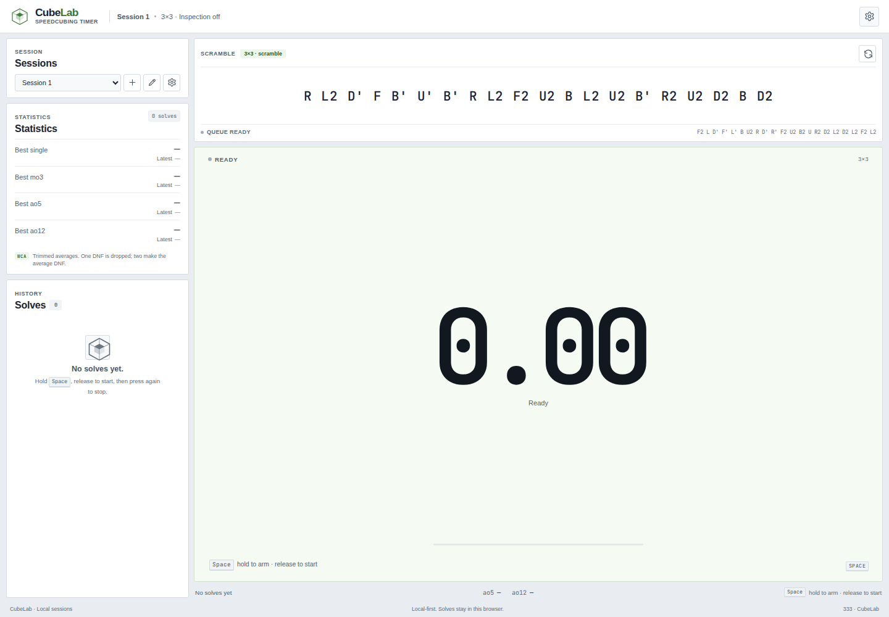
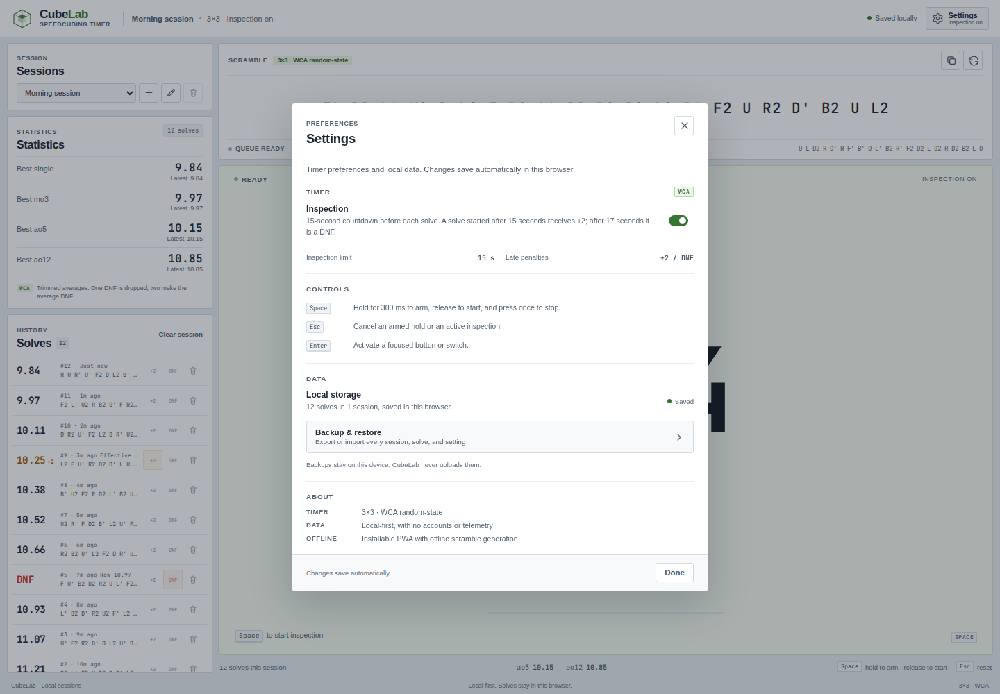
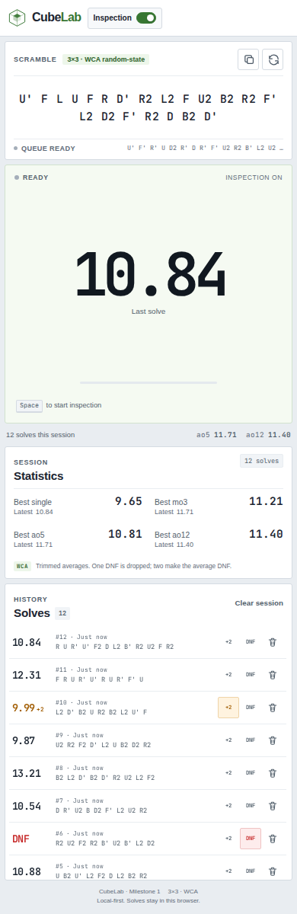

# CubeLab

**A focused, offline-first speedcubing timer with session-level event support.**

CubeLab is a focused, offline-first speedcubing timer with a flat,
csTimer-inspired interface. It combines a precise monotonic timer, official WCA
random-state scrambles from `cubing.js` for 3×3, 2×2, 4×4, and 3×3 OH, optional
WCA inspection with count-down or count-up display and independent 8/12-second
warnings, WCA-aware statistics from single through ao10000 plus custom averages,
named local sessions with per-session settings, JSON backup/restore, optional
Google Drive synchronization, and a floating solve action menu in a responsive
layout built around the clock. See [`ROADMAP.md`](ROADMAP.md) for the planned
phases and their acceptance gates.



## Features

- **Monotonic timing** with a configurable hold-to-arm gesture (300 ms by
  default) and frame-accurate display.
- **Official random-state scrambles** generated by `cubing.js` for the session's
  event (3×3, 2×2, 4×4, or 3×3 OH), with a prefetched next scramble.
- **Keyboard and pointer controls** that work reliably from anywhere on the page,
  including an optional **Stop with any key** setting while timing.
- **Optional WCA inspection** with automatic `+2` and DNF penalties, a
  count-down or count-up display, and independent optional warnings when the
  displayed inspection time reaches **8 seconds** or **12 seconds**.
- **csTimer-inspired Settings dialog** with Timer, Alerts, Display, Appearance,
  Statistics, Scramble, Controls, Data, and About sections. It covers inspection
  direction and warnings, timer updates, Space-hold time, an optional any-key
  stop, visual/sound/haptic solve and DNF alerts with adjustable volume, accent
  color, visible statistics, custom averages, display precision, display
  scaling, scramble presentation, local-data status, and backup/restore access.
  Changes save automatically.
  Enabled inspection warnings always show their text; sound and haptic follow
  the selected feedback channel. DNF feedback is slightly louder than solve
  feedback at the same volume setting.
- **Named local sessions** with create, switch, rename, and a per-session
  settings gear for inspection override, clear, and confirmed delete. Each
  session has independent solves and statistics.
- **Session statistics**: best/latest single, mo3, ao5, ao12, ao25, ao100, ao200,
  ao500, ao1000, ao5000, and ao10000, plus up to five custom trimmed averages
  from ao3 to ao10000. All averages use full WCA DNF handling.
- **Solve history** containing the raw time, penalty, scramble, timestamp,
  optional comment, and a stable unique ID. Click a row or press <kbd>Enter</kbd>
  to open a floating action menu. Each row also has inline **+2** and **DNF**
  controls, while other actions remain in the menu.
- **Solve actions**: add/remove `+2`, mark/clear DNF, delete with undo, copy the
  scramble, solve time, or full solve text, and add or edit a persisted comment.
  Session clearing and deletion live in the session settings gear.
- **JSON backup and restore** covering every session, solve, and setting. Imports
  are validated and replace local data only after explicit confirmation.
- **Optional Google Drive synchronization** using device-owned snapshots,
  field-level merging for solves, session metadata, preferences, and global
  settings, plus manual conflict review. It defers while the timer is active and
  never runs before you explicitly connect a Google account.
- **Local-first persistence** with versioned, validated browser storage and
  automatic migration from the original single-session key.
- **Installable PWA** with full offline operation after the first visit.
- **Responsive, accessible UI** for desktop, tablet, and mobile, including 28 px
  touch targets, visible focus states, modal focus containment, and WCAG AA
  secondary-text contrast.

## Interface

The layout follows the familiar speedcubing-timer structure: a session switcher,
session statistics, and solve history in the left rail; the scramble above the
timer; and the clock as the dominant element. The flat light theme uses neutral
panels, a pale accent-tinted timer surface, and a solid accent available in
green, blue, violet, or amber. There are no decorative gradients, glows, or
background effects. On narrow screens the timer comes first, with the session
controls, statistics, and history stacked below it.

The header **Settings** button opens a csTimer-inspired preferences dialog. The
dialog groups timer, alerts, display, appearance, statistics, scramble, controls,
data, and about preferences in one place, with progressive migration from older
settings records. At 320 px the Settings dialog keeps the inspection label and
its switch touch target visible, and its body scrolls independently so the Done
button stays reachable. The desktop history rail scrolls internally rather than
stretching the page. Offscreen history rows are skipped during rendering and
memoized, so long sessions remain usable. Solve rows open a compact menu anchored
near the row; the menu stays inside the viewport on narrow screens.



### Mobile layout



## Controls

| Action | Input |
| --- | --- |
| Arm the timer | Hold <kbd>Space</kbd>, or press and hold the timer surface, for the configured hold time (300 ms by default) |
| Start timing | Release <kbd>Space</kbd> or the pointer |
| Stop timing | Press <kbd>Space</kbd>, click, or tap once; if **Stop with any key** is enabled in **Settings → Timer**, any non-modifier key also stops the running timer |
| Cancel a hold or inspection | <kbd>Esc</kbd> |
| Regenerate the scramble | Use the regenerate button in the scramble panel |
| Copy or advance the scramble | Click either side of the scramble text when that action is enabled in **Settings → Scramble** |
| Open Settings | Use the gear button in the header; it is unavailable while timing |
| Change the global inspection default | Open **Settings**, then toggle **Inspection** under **Timer** |
| Override inspection for one session | Open the session settings gear, then toggle **Inspection for this session** |
| Choose count-down or count-up inspection | Open **Settings → Timer → Inspection timer** |
| Show 8-second or 12-second warnings | Open **Settings → Alerts → Inspection warnings** |
| Tune timer updates, Space hold, scramble layout, and display scaling | Open **Settings**, then adjust **Timer**, **Display**, or **Scramble** |
| Choose solve/DNF and inspection feedback | Open **Settings → Alerts** and choose visual, sound, haptic, or a combination |
| Adjust alert volume | Open **Settings → Alerts** and move the **Alert volume** slider |
| Change the accent color | Open **Settings → Appearance** and choose green, blue, violet, or amber |
| Show or hide statistic cards, add custom averages, and choose precision | Open **Settings → Statistics** |
| Switch session | Choose a name in the session select; use arrow keys and <kbd>Enter</kbd> from the keyboard |
| Create or rename a session | Use the buttons beside the session select |
| Clear or delete a session | Open the session settings gear beside the select |
| Open solve actions | Click a solve row or focus it and press <kbd>Enter</kbd> |
| Add a solve comment | Open solve actions, choose **Add comment**, then **Save comment** |
| Export or import a backup | Open **Settings → Data → Backup & restore** |
| Manage Google Drive synchronization | Open **Settings → Data → Google Drive backup**, then connect and use automatic or manual **Sync now** |
| Activate a focused button or switch | <kbd>Enter</kbd> |

<kbd>Space</kbd> is reserved for timing throughout the app and never scrolls the
page. Buttons and switches remain keyboard-operable with <kbd>Enter</kbd>. Space
is only left to a control when focus is inside a text-entry field, such as the
session-name or solve-comment editor.

### Sessions

CubeLab starts with one local session named **Session 1**. New sessions receive
the next unused default name, and names are trimmed, limited to 40 characters,
and unique case-insensitively. The active session determines the statistics,
history, and solve count shown in the interface. Session controls are disabled
while the timer is armed, running, or in inspection so a solve cannot move
between sessions mid-timing.

The gear beside the session select opens **Session settings**. It controls the
session's inspection override, clearing all solves, and deleting the session.
Clearing requires typing **CLEAR THIS SESSION**; deleting requires typing
**DELETE THIS SESSION**. Deleting always leaves at least one session. The
original single-session data from earlier CubeLab versions is migrated
automatically into **Session 1** the first time the new version loads; only
3×3 records from that legacy key are migrated. Open browser tabs are not
synchronized with each other, so use one tab when changing sessions or importing
a backup. Duplicate session names are rejected while you type, with the field,
icon, and message highlighted in red.

### Backup and restore

Open **Settings → Data → Backup & restore**. **Backup** exports a readable JSON
file containing every session, every solve, the active session, and all
settings. The file is created locally with the browser download API; CubeLab
never uploads it.

Import validates the application marker, format version, sessions, solves, and
settings before changing anything. Valid data replaces the local sessions and
settings only after a confirmation dialog explains the current and incoming
counts. Cancelling the confirmation leaves local data untouched. Imports are
limited to 10 MB; invalid files produce an inline error and are not applied.

### Google Drive synchronization

Open **Settings → Data → Google Drive backup**. Connect with Google Identity
Services to obtain an access token for the app-data scope. CubeLab saves completed
solves locally immediately, then downloads, compares, merges, saves, and uploads
cloud changes. The timer is never interrupted: if a scheduled or manual sync is
requested while the timer is armed, running, or inspecting, it is deferred and
resumed once when the timer is idle.

Each browser writes its own snapshot named
`cubelab-backup-<device-id>.json` in Google Drive app data. Every run lists every
page of app-data files, validates, and merges **all** CubeLab snapshots,
including the legacy fixed-name `cubelab-backup.json` from earlier releases. A
device only replaces its own snapshot, so simultaneous uploads from different
devices cannot overwrite one another. Invalid or unsupported snapshots are
rejected before local mutation. Deleting remote backups removes every CubeLab
snapshot, including the legacy file, and reports partial failures instead of
claiming complete success.

Automatic synchronization is enabled only after the user connects Google Drive.
It defaults to combined mode at 5 minutes or 10 solves, whichever comes first,
with minimum values of 1 minute and 1 solve. Startup, exit, and reconnection
synchronization are available as advanced options. Failed automatic syncs retry
with bounded backoff; when that budget is exhausted, CubeLab pauses automatic
retries and asks you to use **Sync now**.

There is no separate manual **Backup now** button and no
**Restore from Drive** button. Synchronization is the reconciliation path:
**Sync now**, startup sync, and automatic scheduling all merge local and cloud
sessions and solves. Sessions, solves, and tombstones merge by stable ID.
Session name, event, inspection override, session preferences, and global
settings merge field by field, with the newest field timestamp winning and a
stable tiebreak when timestamps match. Equal legacy fields do not acquire
fabricated history.

Same-field edits are merged automatically unless manual review is enabled. With
manual review, CubeLab pauses cloud publication and lists pending conflicts for
solve fields, session metadata, session preferences, global settings, and
session redirects. Each conflict shows both values and **Use this device** /
**Use cloud** actions; synchronization resumes after the last one is resolved.
An approval only applies to the exact reviewed values and timestamps, so an edit
made after the prompt creates a fresh conflict instead of being overwritten.

Separate sessions that share a name are never merged automatically. CubeLab
recomputes collisions against the final merged collection and shows a **Review
Merge** action in the sync notification; the Drive dialog also keeps a persistent
duplicate-name notice and review action while the collision remains. Choosing
**Review Merge** opens a typed-confirmation dialog that previews the destination,
source, and resulting solve count.

If a device adds solves to a session after another device deleted it, those
solves are moved into a clearly labelled **Session (recovered)** rather than
being lost. Later offline devices merge their solves into that recovered session
by solve ID. New session tombstones record the deleting device's known solve IDs,
allowing unknown offline solves to be recovered even when device clocks
disagree; legacy tombstones use the timestamp fallback.

Synchronization is not a substitute for the local JSON backup. Google Drive still
does not provide verified atomic compare-and-swap protection in this transport.
Device-owned snapshots remove the cross-device overwrite race. Automatic sync and
manual backup also share a Web Lock and re-list this device's snapshot immediately
before writing; if another writer changed it, the write is aborted and retried.
That removes the avoidable same-origin tab race, but two tabs or profiles sharing
the same device identity can still race between the recheck and the request.
In-flight guards prevent a download from replacing solves recorded while it was
running, but neither mechanism makes the remote write transactional. See
[`PATCH_LIMITATIONS.md`](PATCH_LIMITATIONS.md) for the remaining sync
limitations.

Google Drive synchronization is optional; all timer, session, storage, and local
JSON backup features work without it. Build with `VITE_GOOGLE_CLIENT_ID` to
enable the controls; otherwise the dialog explains that Drive is not configured.
OAuth tokens are kept in memory only and are not stored in `localStorage`. The
connected account label is stored locally. Deleting the remote backup does not
change local sessions or settings.

### Inspection rules

When inspection is enabled, the first press starts the 15-second inspection.
The solve starts from a second hold:

- **0–15 s:** no penalty
- **15–17 s:** `+2`
- **Over 17 s:** `DNF`

Inspection can display a countdown from 15 to 0, or count up from 0 to 17. The
optional **8 seconds** and **12 seconds** warnings are independent and follow the
displayed direction: count-up warns at 8 seconds and 12 seconds elapsed;
count-down warns at 7 seconds and 3 seconds remaining, matching the same
elapsed points. The visual warning can pulse the timer surface or the entire
screen according to **Settings → Alerts → Inspection warning display**. The
penalty is determined at the moment timing starts. `Esc` cancels inspection
penalty is determined at the moment timing starts. `Esc` cancels inspection
before the solve begins. Inspection cannot be changed while timing is active;
the header Settings button is disabled until the timer returns to idle.

## Statistics

All times are stored as raw milliseconds and penalties are applied afterward.

- **Single:** the effective solve time; `+2` adds two seconds and DNF is invalid
  for records.
- **mo3:** the mean of the three most recent solves. Any DNF makes it a DNF.
- **ao5 through ao10000:** the trimmed mean of the most recent N solves. The
  best and worst results are removed. One DNF is treated as the worst result and
  trimmed; two or more DNFs make the average a DNF.
- **Custom averages:** up to five additional trimmed averages from ao3 to
  ao10000. Built-in sizes such as ao5 and ao12 are excluded because they are
  already available.
- **Best** values scan every valid window in the session; a DNF is never reported
  as a personal best. Large averages use a Fenwick-tree sliding-window pass so
  ao1000–ao10000 remain responsive.

**Settings → Statistics** can hide individual cards, add or remove custom
averages, and switch the displayed precision between hundredths and tenths. This
is presentation only: stored raw times, penalties, and WCA calculations always
use centiseconds.

## Getting started

Requirements: Node.js 20+ and npm.

```bash
npm install
npm run dev
```

Open the printed local URL. The app has no CubeLab backend, account, analytics, or
telemetry. Optional Google Drive synchronization is the only network feature and
runs only after you explicitly connect a Google account.

### Production build

```bash
npm run build
npm run preview
```

The production build emits an installable PWA and a Workbox service worker that
precaches the application shell, fonts, scramble assets, and worker code.

## Verification

```bash
npm run typecheck   # strict TypeScript project build
npm run lint        # Oxlint
npm test            # Vitest unit and integration tests
npm run build       # production build + PWA generation
npm run test:e2e    # Playwright against the production preview
```

`npm run check` runs the core verification chain.

The Playwright suite builds and serves the production output, then verifies
keyboard timing, solve-menu penalties, comments, clipboard copying, delete/undo,
typed clear confirmation, Settings open/close and focus restoration, inspection
persistence and direction, count-down and count-up warnings, per-session
inspection overrides, mobile pointer timing, 320 px Settings/session/solve-menu
targets, long-history scrolling, legacy single-session migration, named-session
create/switch/rename/delete with typed confirmation, timer locking of session
controls and Settings, backup export, invalid-file handling, import cancellation,
confirmed restore of sessions/comments/settings, the scramble-failure recovery
state, and full offline scramble generation through the installed service
worker. It also covers visual solve and DNF alerts, adjustable alert volume,
accent persistence, the Controls reference, expanded/custom statistics, tenths
precision, Google Drive mock synchronization, conflict review, duplicate-name
review/merge, and delete-all remote backup wording.

## Architecture

```text
src/
  timer/machine.ts       Pure timer state machine and inspection penalties
  hooks/useTimer.ts      React adapter, monotonic clock, single-record guarantee
  hooks/useScramble.ts   Prefetched cubing.js scramble queue
  hooks/useSessions.ts   Authoritative named-session state and persistence
  hooks/useSettings.ts   Persisted preferences
  hooks/useModalDialog.ts Native modal lifecycle and focus containment
  lib/sessions.ts        Pure session, solve, comment, and name mutation logic
  lib/backup.ts          Versioned JSON backup creation and validation
  lib/sync.ts            Solve/session/tombstone/redirect merge logic
  lib/sessionMetadata.ts Field-level session metadata merging
  lib/settingsMerge.ts   Field-level global-settings merging and provenance
  lib/remoteBackups.ts   Read/merge/delete all device-owned Drive snapshots
  lib/driveTransport.ts  Google Drive/mock transport and paginated file listing
  lib/driveCoordination.ts  Same-origin write lock and own-snapshot revalidation
  lib/scramble.ts        cubing.js random-state integration
  lib/statDefinitions.ts Built-in statistics and custom-average validation
  lib/stats.ts           WCA single, mo3, built-in, and custom average calculations
  lib/storage.ts         Versioned localStorage validation and migration
  lib/alerts.ts          Web Audio, vibration, DNF gain, and inspection warnings
  lib/format.ts          Display formatting
  hooks/useSync.ts       Merge orchestration, scheduling, retries, and conflicts
  hooks/useDriveBackup.ts Drive connection, per-device backup, and remote deletion
  components/            Timer, scramble, sessions, stats, history, and dialogs
  components/SettingsDialog.tsx  Timer, Alerts, Display, Appearance, Statistics,
                                 Scramble, Controls, Data, and About preferences
  components/SessionSettingsDialog.tsx  Per-session inspection, clear, and delete
  components/SolveHistory.tsx  History rows and the floating solve action menu
  App.tsx                Integration, global input, session/backup orchestration
  index.css              Flat csTimer-inspired theme and responsive layout
e2e/timer.spec.ts        Production browser and offline tests
```

The timer is a pure state machine driven by timestamped events. The React layer
only adapts input, renders state, and keeps a ref-backed authority so two events
in the same frame cannot record the same solve twice.

### Persistence

Storage keys are versioned:

- `cubelab:sessions:v1` — the active session ID and every named session, each
  containing its solves.
- `cubelab:settings:v1` — local preferences.
- `cubelab:solves:v1` — the original single-session key, read only to migrate
  existing 3×3 solves into **Session 1**.
- `cubelab:drive:v1` — optional Google Drive connection metadata (account label
  and last remote file identity); OAuth tokens stay in memory.
- `cubelab:sync:v1` — optional synchronization preferences and runtime state:
  device ID, tombstones, redirects, conflict records, settings field timestamps,
  and the last published fingerprint.

Each session contains `id`, `name`, optional `event` and `preferences`,
`createdAt`, `updatedAt`, `solves`, an optional `inspectionEnabled` override, and
optional `fieldUpdates` metadata for the name, event, inspection override, and
individual preference fields. Each solve contains `id`, `event`, `rawMs`,
`penalty`, `scramble`, `comment`, and `createdAt`, plus optional per-field merge
metadata. Invalid sessions, solves, duplicate IDs, and malformed metadata are
skipped individually. Corrupt session JSON falls back to the legacy record and
then to a fresh empty session; a valid session collection is never silently
discarded. The active session is normalized to an existing session on load.
Sessions are stored at schema version 4; version 1–3 records load with defaults
for newer fields. Missing field metadata falls back to `updatedAt` only at merge
time and is not written back as fabricated history.

Settings are stored at schema version 6. Version 1–5 records are upgraded in
place with field-level defaults for newer settings; invalid individual values
fall back without discarding the rest of the record. Global settings field
timestamps are stored in `cubelab:sync:v1` rather than in the settings record, so
the settings schema remains backward compatible.

Backups use `{ app: "CubeLab", format: "cubelab-backup", version: 1,
exportedAt, sessions, settings, sync? }`. The parser validates the marker,
version, sessions, solves, and settings before the confirmation step. The optional
sync envelope carries the cloud revision, tombstones, conflict records, session
redirects, and settings field timestamps.

### Production worker note

`cubing.js` creates its search worker from a chunk URL instead of Vite's worker
pipeline. The production configuration therefore isolates the cubing modules in
a dedicated chunk and disables module preloading. Without that isolation,
Rolldown merges shared worker modules into the browser entry, which then executes
React inside the worker and fails with `document is not defined`. The offline
Playwright test is the regression guard for this setup. Do not remove the
`manualChunks` or `modulePreload: false` settings without rerunning that test.

## Privacy

All sessions, solves, and settings stay in the browser's local storage by
default. Backup files are created and read locally by the browser. If you
explicitly connect Google Drive, synchronization uploads a device-owned
versioned snapshot to CubeLab's app-data folder in your own Drive account; there
is no CubeLab account, backend, analytics, or telemetry.

## Scope

CubeLab Milestone 1, Phase 2A, Phase 2A.1, Phase 2A.2, Phase 2A.3, Phase 2B,
and Phase 2C are complete. Phase 2A adds local named sessions and JSON
backup/restore. Phase 2A.1 adds the csTimer-inspired Settings dialog,
centralizing the inspection preference and local-data controls. Phase 2A.2 adds
alert feedback, accent colors, statistics display controls, and the Controls
reference. Phase 2A.3 adds count-down/count-up inspection with independent
warnings, expanded and custom statistics, per-session settings, typed destructive
confirmations, persisted solve comments, and the floating solve action menu.
Phase 2B introduced manual Google Drive backup and restore. Phase 2C supersedes
those manual-only controls with optional local-first Google Drive
synchronization using device-owned snapshots, field-level session and settings
merging, tombstones, conflict review, and scheduled sync.

Sessions can be set to 3×3, 2×2, 4×4, or 3×3 OH and use `cubing.js` scrambles for
the selected event. Additional events, social features, and non-Google cloud
providers remain outside scope. Device-owned snapshots avoid cross-device file
overwrites, but Google Drive does not provide verified atomic compare-and-swap
protection here, so tabs or profiles sharing one device identity can still race;
see [`PATCH_LIMITATIONS.md`](PATCH_LIMITATIONS.md).

For implementation status and handoff details, see
[`PROJECT_PROGRESS.md`](PROJECT_PROGRESS.md). Contributors and future agents
should also read [`AGENTS.md`](AGENTS.md).
