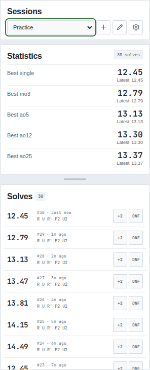
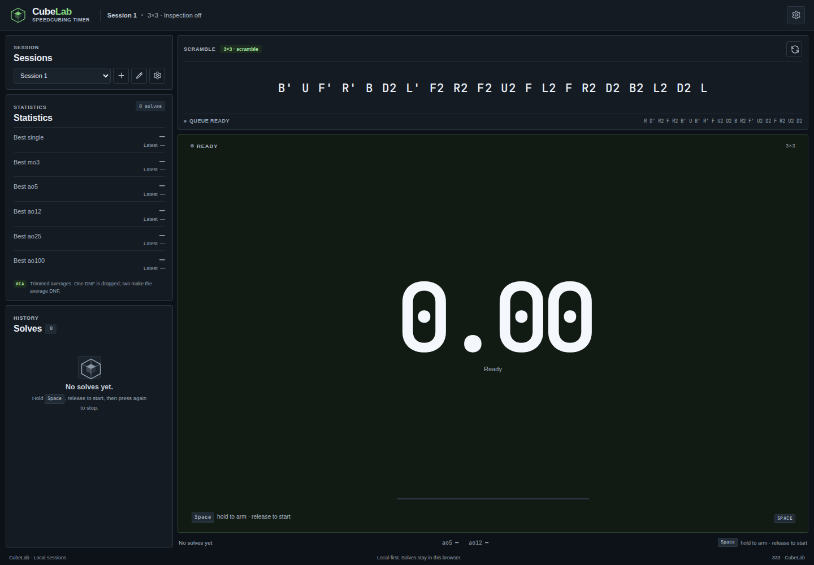
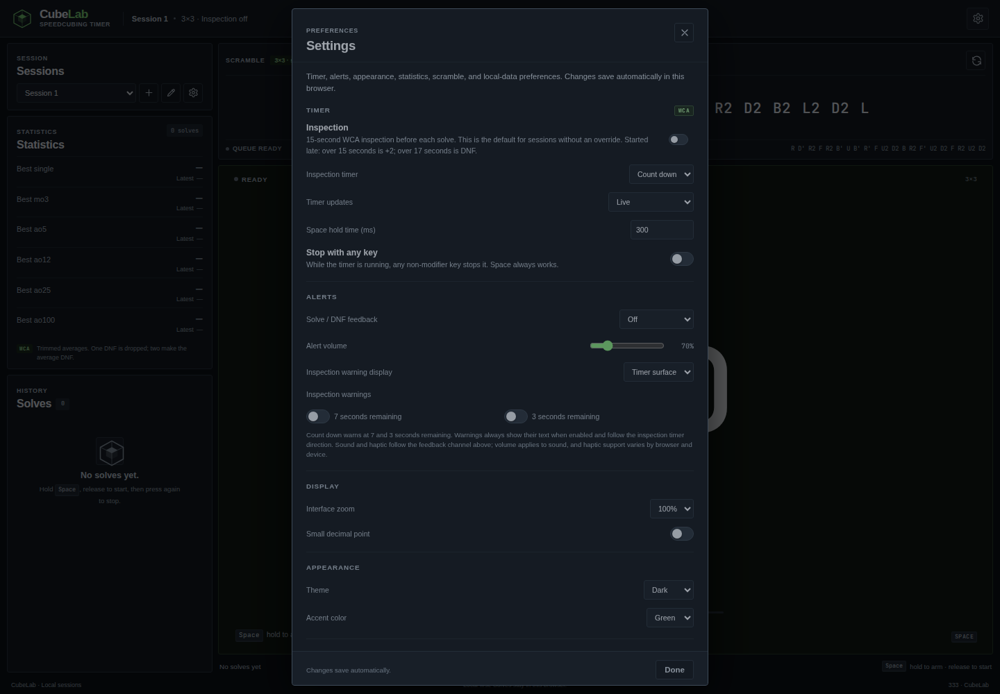
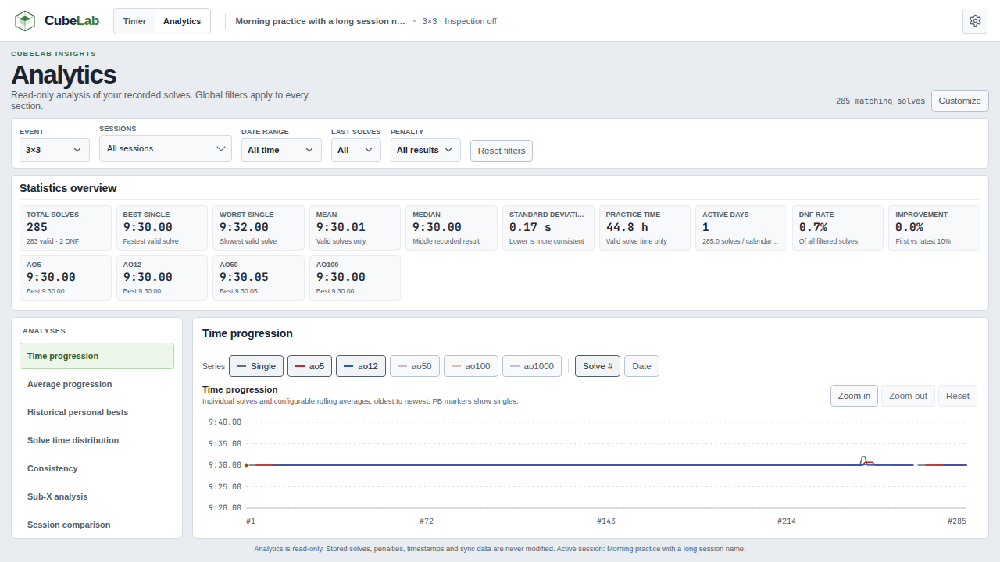
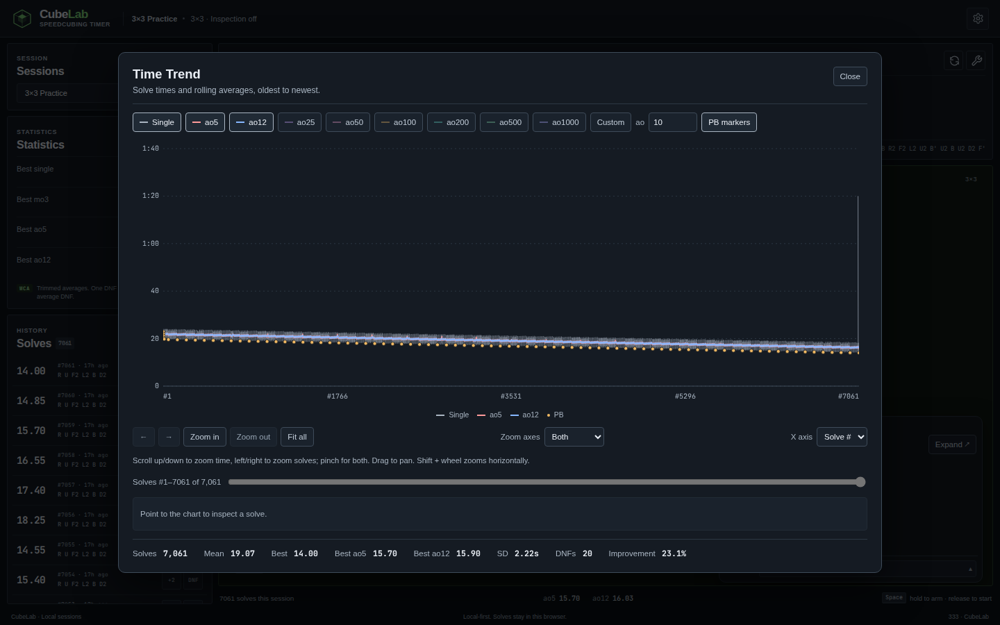
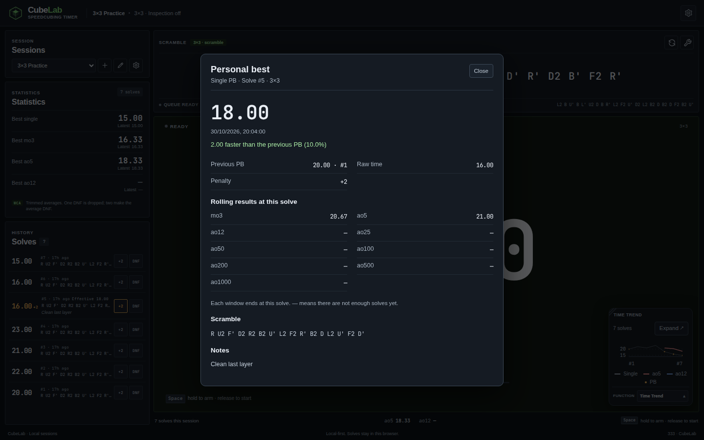
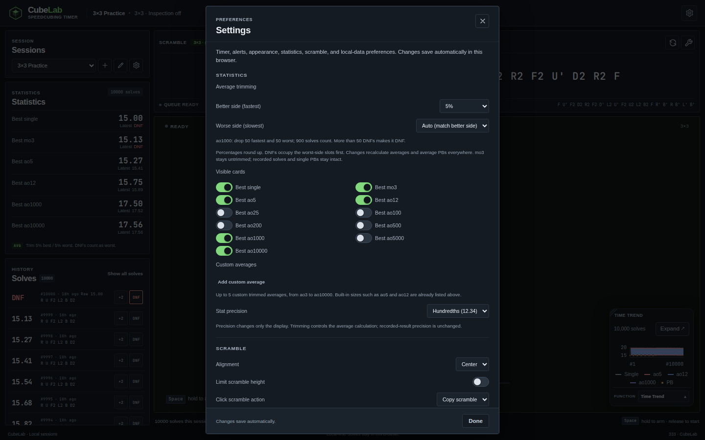

# CubeLab

**A focused, offline-first speedcubing timer with session-level event support.**

CubeLab is a focused, offline-first speedcubing timer with a flat,
csTimer-inspired interface. It combines a precise monotonic timer, official WCA
scrambles from `cubing.js` for 12 events — 3×3, 2×2, 4×4, 3×3 OH, 5×5, 6×6,
7×7, Pyraminx, Skewb, Square-1, Clock, and Megaminx — optional WCA inspection
with count-down or count-up display and
independent 8/12-second warnings, WCA-aware statistics from single through
ao10000 plus custom averages, named local sessions with per-session settings,
JSON backup/restore, optional Google Drive synchronization, a dedicated analytics
dashboard, an optional Draw Scramble diagram, and a floating solve action menu
in a responsive layout built around the clock. The interface offers audited light and dark palettes plus a
system-following theme. See
[`ROADMAP.md`](ROADMAP.md) for the planned phases and their acceptance gates.


The header switches between the timer and the read-only Analytics dashboard.
Timer state and session data are shared; opening Analytics never changes stored
solves.

## Features

See [FEATURES.md](FEATURES.md) for the complete current feature inventory,
including interaction rules, settings defaults, session overrides and persistence scope.

- **Monotonic timing** with a configurable hold-to-arm gesture (300 ms by
  default) and a display refreshed with browser animation frames.
- **Large-session stop feedback** captures the input time before audio/focus work.
  The live readout updates independently, and statistics, history and charts
  refresh after the final result gets a rendering opportunity. Saving and
  synchronization continue to use the current, complete solve data.
- **Official WCA scrambles** generated by `cubing.js` for the session's event
  (3×3, 2×2, 4×4, 3×3 OH, 5×5, 6×6, 7×7, Pyraminx, Skewb, Square-1, Clock, or
  Megaminx), with a prefetched next scramble and explicit loading, failure, and
  retry states.
- **Custom events** for puzzles without an official generator. Create, rename,
  or delete a custom event from **Session settings → Manage custom events**,
  choose an optional text placeholder shown instead of a scramble, and record
  solves with the normal timer, inspection, sessions, statistics, Analytics, and
  PB tracking. Custom-event solves remain separate from every built-in event.
- **Merge and split sessions** from **Session settings**. Merge one or more
  same-event sources into a destination with a counted preview; split selected
  solves or ranges into a new session that copies the source event/settings and
  is inserted next to it. Solve IDs and fields are preserved, and durable
  ownership records keep moved solves correct through reloads, backups,
  cross-tab adoption, and stale cloud snapshots.
- **Draw Scramble tool** opened with the scramble panel's **Current tool**
  button. The button toggles a compact panel in the bottom-right of the timer
  area; the panel's footer **Function** dropdown selects the tool. The panel
  can be dragged by its header and resized from its bottom-right corner, with
  the resulting position and size persisted locally. It is pointer-isolated from
  the timer, follows the live scramble and event, and shows either a
  colour-accurate 2D unfolded net for every supported N×N puzzle or the
  `cubing.js` PG3D render. The 2D net uses the standard cube colour scheme
  (U white, D yellow, F green, B blue, R red, L orange); non-cube puzzles show
  an honest "2D net is not available" message in 2D mode and render their
  correct 3D puzzle in 3D mode. The 2D/3D choice lives only in
  **Settings → Scramble**.
- **Time Trend tool** selected in the panel's **Function** menu. The compact
  chart fills the panel and keeps PB markers small. Click a PB marker (or focus
  it and press **Enter**) to open its read-only statistics: recorded time,
  previous PB and improvement, rolling results ending at that solve, raw time,
  penalty, date, scramble, and notes. The stats dialog works in both chart
  views and returns focus to the marker when closed. The chart plots recorded solve
  results and rolling averages from oldest to newest, includes slow outliers,
  leaves gaps for DNFs, and never uses negative time labels. **Expand** opens
  a responsive dialog with series and PB toggles, custom averages (ao3–ao10000),
  zoom, earlier/later controls, a range slider, a real date axis, solve details,
  and range statistics. With the pointer over either chart, two-finger up/down
  scrolling (or the mouse wheel) zooms time vertically, and left/right scrolling
  zooms solve history horizontally. **Shift + wheel** also zooms horizontally;
  a trackpad pinch zooms both axes around the pointer. Click and drag to pan.
  **Zoom axes** chooses which axes the expanded-view zoom buttons affect.
  **Fit all** resets both axes, and the compact **Fit** button does the same.
  Horizontal navigation keeps the vertical scale fixed. Expanding is
  disabled during timing; the dialog contains keyboard focus and closes with
  Escape, returning focus to **Expand**.
- **Analytics dashboard** opened from the header **Analytics** tab. Global event,
  session, date-range, latest-count, and penalty filters drive overview cards,
  time and average progression, historical PBs, a clickable distribution,
  consistency and Sub-X analysis, session comparison, practice activity,
  advanced percentiles/rankings, and a filtered solve-list dialog. Charts support
  hover, keyboard inspection, zoom, pan, and reset; solve points and list rows
  open a read-only detail dialog. The Statistics overview stays at the top and a
  left analysis list (or narrow-screen dropdown) shows one analysis at a time;
  on narrow screens the filter controls collapse behind a **Filters** button
  that shows the active-filter count. Visibility and order preferences merge
  with the other global settings.
  Practice activity covers the complete filtered date range with year-aware
  labels, and the Sub-X session breakdown shares a resizable split with its
  chart. Analytics is lazy loaded, calculation results are memoized, large lines
  are downsampled, and no analytics calculation runs while the timer is active.
  A subtle display version in the bottom-right footer identifies the running
  build.
- **CubeLab-themed dropdowns** replace native select menus throughout the app,
  including Settings, session and event pickers, Analytics filters, import and
  Drive dialogs, and tool controls. They match both themes, support arrow keys,
  Home/End, Enter, Escape, type-ahead, touch and screen readers, close on outside
  presses, return focus to the trigger, and stay inside the viewport and modal
  focus containment. Space operates a focused dropdown's own menu rather than
  starting or stopping the timer.
- **Global keyboard controls** outside text-entry fields and modal dialogs,
  plus pointer controls on the timer surface. An optional **Stop with any key**
  setting stops a running solve with a non-modifier key. Timer keys are disabled
  while the Analytics page is open.
- **Optional WCA inspection** with automatic `+2` and DNF penalties, a
  count-down or count-up display, and independent optional warnings when the
  **8 or 12 seconds have elapsed** (7 or 3 seconds remaining in count-down mode).
- **csTimer-inspired Settings dialog** with Timer, Alerts, Display, Appearance,
  Statistics, Scramble, Data, a collapsed Developer options section,
  and About. It covers inspection direction and warnings, timer updates,
  Space-hold time, an optional any-key stop, visual/sound/haptic solve and DNF
  alerts with adjustable volume, a light/dark/system theme, accent color,
  visible statistics, custom averages, display precision, display scaling,
  optional current-session solve progress and total time, scramble presentation
  (including the Draw Scramble 2D/3D visualization), local-data status, and
  backup/restore access. Changes save automatically.
  Enabled inspection warnings always pulse visually and announce a direction-aware
  label through the live region; there is no warning-text overlay. Sound and
  haptic follow the selected feedback channel. DNF feedback is slightly louder than solve
  feedback at the same volume setting.
- **Named local sessions** with create, switch, rename, reorder, and a per-session
  settings gear for event correction, inspection override, clear, and confirmed
  delete. Each session has independent solves and statistics. The session
  selector contains separate selection, drag-handle, and accessible
  **Up**/**Down** move controls, so reordering never changes the active
  session. Order persists locally, is included in backups, and synchronizes
  across devices.
- **Configurable average trimming** in **Settings → Statistics**. Choose better
  and worse sides independently, with a 5% better-side default and **Auto** on
  the worse side. Options include 0/1 solve, 1%, 5%, 10%, 20%, and median.
  The same policy recalculates averages and average PBs in cards, quick stats,
  the trend graph, and historical PB details; stored solves and single PBs
  remain intact.
- **Session statistics**: best/latest single, mo3, ao5, ao12, ao25, ao100, ao200,
  ao500, ao1000, ao5000, and ao10000, plus up to five custom trimmed averages
  from ao3 to ao10000. All averages honor the configured trimming and DNF rules.
- **Solve history** containing the raw time, penalty, scramble, timestamp,
  optional comment, and a stable unique ID. Click a row or press <kbd>Enter</kbd>
  to open a floating action menu. Wider layouts also show inline **+2** and
  **DNF** controls; narrow layouts keep every action in the row menu to avoid
  crowding the timestamp and scramble.
- **Solve actions**: add/remove `+2`, mark/clear DNF, delete with a durable
  synchronized undo, copy the scramble, solve time, or full solve text, and add
  or edit a persisted comment.
  Session clearing and deletion live in the session settings gear.
- **JSON backup and restore** covering every session, solve, and setting. Imports
  are validated and replace local data only after explicit confirmation.
- **Developer options** in Settings are collapsed by default. **Danger Zone**
  provides two typed-confirmation actions: **Reset All Solve Data** removes every
  solve while keeping session names, event assignments, preferences, custom
  event definitions, and application settings; **Delete All Sessions** removes
  every session and solve, then creates one empty active **Session 1** while
  preserving settings and custom-event definitions. Both record durable
  deletion metadata for synchronization; existing Google Drive snapshots are not
  deleted by either action.
- **csTimer `.txt` / `.json` import** detects the csTimer format automatically
  and shows a concise preview table of every session name and solve count,
  including empty sessions. Sessions are appended in csTimer `rank` order, with
  the session number as the deterministic fallback and tie-breaker. Original
  names are preserved, including numeric names; conflicting names are resolved
  case-insensitively against both local and imported sessions with
  `name(1)`, `name(2)`, and so on, while existing stored sessions keep their
  names. Valid omitted `opt.scrType` metadata uses csTimer’s `333` default;
  explicit supported identifiers map to built-in events, and explicit
  unsupported identifiers become stable custom events that can be renamed later
  in the custom-event manager. Missing or malformed metadata is not treated as
  a 3×3 default. Imported solves retain penalties, scrambles, comments,
  original dates, and csTimer provenance (including whether the type was
  explicit or default). Empty sessions are imported with import time as the
  fallback when their dates are missing or unusable. Invalid durations, dates
  for sessions with solves, malformed solve lists, or malformed rows reject the
  file with a session/solve error before preview or confirmation. Missing solve
  dates retain the existing session-date/current-time fallback; valid imports
  add sessions and custom definitions while leaving existing settings and
  history unchanged.
- **Optional Google Drive synchronization** using device-owned snapshots,
  field-level merging for solves, session metadata, preferences, and global
  settings, plus manual conflict review. Custom event definitions merge by stable
  ID, including deletions, so repeated imports or cloud merges cannot create
  duplicate events. It defers while the timer is active and never runs before you
  explicitly connect a Google account.
- **Local-first persistence** with versioned, validated browser storage and
  automatic migration from the original single-session key.
- **Installable PWA** with local timing and scramble generation available offline
  after the production service worker and assets finish caching. Drive operations
  require a network connection; offline coverage is Chromium-only in this harness.
- **Responsive, accessible UI** for desktop, tablet, and mobile, including 28 px
  touch targets, visible focus states, modal focus containment, and WCAG AA
  secondary-text contrast.

## Interface

The layout follows the familiar speedcubing-timer structure: a session switcher,
session statistics, and solve history in the left rail; the scramble above the
timer; and the clock as the dominant element. When Draw Scramble is active, its
compact diagram panel floats over the bottom-right of the timer area. It is
absolutely positioned and never participates in the readout's layout, so opening,
closing, dragging, resizing, or switching tools leaves the centered timer fixed.
The base timer and sidebar stack without overlap at short viewports. The flat light and dark themes
use neutral panels, an accent-tinted timer surface, and a solid accent available
in green, blue, violet, or amber. The theme follows **Light**, **Dark**, or
**System** in **Settings → Appearance**; the predefined text/surface and accent pairs in both palettes are
checked against WCAG AA contrast thresholds, and the stored choice is applied before
the first paint. There are no decorative gradients, glows, or background
effects. On narrow screens the timer comes first, with the session controls,
statistics, and history stacked below it. Short portrait and landscape viewports
give the timer a readable minimum height and let the workspace scroll beneath
it, so panels never paint over the readout.

The header **Settings** button opens a csTimer-inspired preferences dialog. The
dialog groups timer, alerts, display, appearance, statistics, scramble, controls,
data, developer, and about preferences in one place, with progressive migration
from older settings records. At 320 px the Settings dialog keeps the inspection label and
its switch touch target visible, and its body scrolls independently so the Done
button stays reachable.

On desktop, drag the divider between Statistics and Solves to resize the
statistics area. Arrow keys resize a focused divider; Shift makes the step
larger, Home/End select the limits, and Enter or a double-click restores the
default split. The split is saved locally with the display preferences. Only
complete enabled statistics are shown when every row is collapsed, with remaining
height shared between rows. Expanding one or more rows switches the statistics
grid to an internal scroll area so Solves stays usable; narrow screens show every
enabled statistic in the stacked layout.



The desktop history rail scrolls internally rather than stretching the page.
Histories above 200 solves are windowed so only the rows
near the visible area render; spacers preserve scroll height and
`aria-setsize`/`aria-posinset` expose the full count. A **Show all solves**
control restores every row for find-in-page and full keyboard traversal. Solve
rows open a compact menu anchored
near the row; the menu stays inside the viewport on narrow screens.




The same palette and accent apply throughout the Settings dialog:



### Custom events

Open **Session settings → Manage custom events** to create, rename, change the
optional scramble placeholder, or delete a definition. Custom events are marked
`(custom)` in every event selector, including the Analytics filter. Deleting is
blocked while a session or solve still uses the event, so history is never
silently moved or orphaned. The same dialog offers bulk session reassignment and
an automatic correction path for solves that retain original csTimer metadata;
correcting an event never changes solve times, timestamps, penalties, comments,
or scrambles.

### Analytics

The Analytics tab analyzes the current solve history without modifying it. Event,
session, date range, latest-solve count, and penalty filters apply to every
analysis. A compact scope toolbar sits below the page title, and the statistics
overview promotes the fastest single, current rolling averages, and total volume
above a dense secondary metric grid. The dashboard shares WCA effective-time,
+2/DNF, precision, and trimming rules with the timer statistics. The overview
stays at the top; below it, a flat analysis list selects one of the remaining
analyses at a time. The **Analysis** heading stays outside the bounded tab
scroller, so switching sections never scrolls or shifts the rail. Narrow screens
replace that list with an accessible **Analysis** dropdown.



On desktop the dashboard fits the available viewport instead of scrolling the
whole page. The overview and selected analysis use bounded internal scrolling;
the selected chart flexes to the remaining height, and longer tables remain
reachable inside the analysis panel. Narrow layouts deliberately keep page
scrolling so controls and text stay readable. Increased interface zoom also
switches the workspace to page scrolling instead of clipping the analysis.

Charts remain interactive at large histories: dense lines use ordered bucket
downsampling, the filtered solve-list dialog virtualizes its rows, and both the
page and its chart code are loaded separately from the timer. Hover or keyboard
inspection shows a per-series tooltip, and histogram tooltips report the
interval, solve count, and share before drill-down. Section visibility,
order, and per-event Sub-X targets are stored in synchronized settings. Retired
Solve explorer entries in older saved layouts are ignored without invalidating
the rest of the customization. The retired width preference also remains in
stored settings for backward compatibility, but the one-analysis panel uses the
full available content width. Solve-time distribution derives its automatic
interval from the central 98% of the current filtered data; extreme values stay
counted in grouped edge intervals and remain drillable, while an explicitly
chosen interval is preserved across filter changes. Sub-X accepts direct seconds
with up to three decimals, offers event-specific presets such as Sub-15/20/30 for
3×3, and retains the per-event target in synchronized settings. Its session
breakdown keeps sticky column headings, every session row, and a keyboard-
resizable chart/table split.

Practice activity uses the earliest-to-latest filtered solve range instead of a
fixed 52-week window. Empty calendar days remain visible, month labels repeat the
year at the start and each January, and the weekly solve-volume axis includes the
year whenever the filtered history spans multiple years. Long ranges scroll
horizontally inside the heatmap. Chart date labels stay compact for single-year
histories.

The compact chart zoom group uses accessible icon buttons for zoom in, zoom out,
and reset, with disabled, hover, active, and focus states in both themes. The
existing wheel/pinch zoom, drag pan, keyboard point inspection, and touch
behavior are unchanged.

### Time Trend

The compact view scales with the tool panel, and the expanded dialog uses the
available desktop or mobile width. PB markers stay visible without dominating
the trend; all selected series share a nonnegative time scale.



Click a PB marker to inspect the result and its rolling statistics at that point:



### Mobile layout


## Controls

| Action | Input |
| --- | --- |
| Arm the timer | Hold <kbd>Space</kbd>, or press and hold the timer surface, for the configured hold time (300 ms by default) |
| Start timing | Release <kbd>Space</kbd> or the pointer |
| Stop timing | Press <kbd>Space</kbd>, click, or tap once; if **Stop with any key** is enabled in **Settings → Timer**, any non-modifier key also stops the running timer |
| Cancel a hold or inspection | <kbd>Esc</kbd> |
| Regenerate the scramble | Use the regenerate button in the scramble panel |
| Show or hide the tool panel | Click the **Current tool** button above the scramble |
| Move the tool panel | Drag the panel's header handle |
| Resize the tool panel | Drag the bottom-right resize handle |
| Select the tool shown in the panel | Use the **Function** dropdown in the panel footer; the panel stays open |
| Inspect a PB | Click its marker in either chart, or focus it and press **Enter**; close the stats dialog with **Close** or **Escape** |
| Open Analytics | Use the header **Analytics** tab; it is unavailable while the timer is active |
| Filter Analytics | Use the event, session, date-range, latest-count, and penalty controls above the dashboard |
| Inspect an Analytics point | Point at a chart for values, or focus it and use the arrow keys; press **Enter** to open the solve details |
| Zoom or pan an Analytics chart | Scroll over the plot to zoom; drag to pan; use **Reset** to restore the full range |
| Drill down from the distribution | Click a histogram bar to open those solves in the solve-list dialog; **Clear interval filter** removes it |
| Choose an analysis | Use the analysis list on the left, or the **Analysis** dropdown on narrow screens; the Statistics overview stays above it |
| Customize Analytics | Use **Customize** to show/hide or reorder the overview and analyses; **Reset layout** restores the defaults |
| Resize the Sub-X breakdown | Drag the divider between the chart and session table, or focus it and use the arrow keys; Home/End select the limits and Enter restores the default |
| View all filtered solves | Use **View solves** in the Analytics heading; select a row to inspect its solve details |
| Zoom and pan Time Trend | Scroll ↕ for vertical zoom, ↔ (or Shift + wheel) for horizontal zoom; pinch for both; drag to pan; **Fit all** resets |
| Explore solve-time trends | Select **Function → Time Trend**, then **Expand** for series, zoom, range navigation, and solve details |
| Choose the Draw Scramble 2D net or 3D puzzle | Open **Settings → Scramble → Draw Scramble visualization** |
| Copy or advance the scramble | Click either side of the scramble text when that action is enabled in **Settings → Scramble** |
| Open Settings | Use the gear button in the header; it is unavailable while timing |
| Change the global inspection default | Open **Settings**, then toggle **Inspection** under **Timer** |
| Override inspection for one session | Open the session settings gear, then toggle **Inspection for this session** |
| Choose count-down or count-up inspection | Open **Settings → Timer → Inspection timer** |
| Show 8-second or 12-second warnings | Open **Settings → Alerts → Inspection warnings** |
| Tune timer updates, Space hold, scramble layout, and display scaling | Open **Settings**, then adjust **Timer**, **Display**, or **Scramble** |
| Choose solve/DNF and inspection feedback | Open **Settings → Alerts** and choose visual, sound, haptic, or a combination |
| Adjust alert volume | Open **Settings → Alerts** and move the **Alert volume** slider |
| Choose a light, dark, or system theme | Open **Settings → Appearance → Theme** |
| Change the accent color | Open **Settings → Appearance** and choose green, blue, violet, or amber |
| Configure average trimming | Open **Settings → Statistics → Average trimming**; changes recalculate averages and average PBs |
| Show or hide statistic cards, add custom averages, and choose precision | Open **Settings → Statistics** |
| Switch session | Open the session selector, then choose a name with the pointer or arrow keys and <kbd>Enter</kbd> |
| Create or rename a session | Use the buttons beside the session selector |
| Reorder sessions | Open the session selector and use each row's accessible **Up**/**Down** buttons; this never changes the active session |
| Close a dropdown | Click or tap outside it, or press <kbd>Esc</kbd>; focus returns to its trigger |
| Correct a session's event | Open the session settings gear and choose an event; sessions with solves require confirmation |
| Clear or delete a session | Open the session settings gear beside the select |
| Open solve actions | Click a solve row or focus it and press <kbd>Enter</kbd> |
| Add a solve comment | Open solve actions, choose **Add comment**, then **Save comment** |
| Export or import a backup | Open **Settings → Data → Backup & restore** |
| Manage Google Drive synchronization | Open **Settings → Data → Google Drive backup**, then connect and use automatic or manual **Sync now** |
| Inspect or clean up remote snapshots | Open **Settings → Data → Google Drive backup → Remote snapshots** |
| Activate a focused button or switch | <kbd>Enter</kbd> |

<kbd>Space</kbd> is reserved for timing throughout the app and never scrolls the
page. Buttons and switches remain keyboard-operable with <kbd>Enter</kbd>.
CubeLab's custom dropdowns use <kbd>Space</kbd> only to open and operate their
own menu, so interacting with a menu never starts or stops the timer. Text-entry
fields such as the session-name or solve-comment editor keep their normal Space
behavior.

### Display version and releases

A subtle version label appears in the bottom-right footer, for example
`0.01.261105:2`. The format is `MAJOR.FEATURE.YYMMDD:PATCH`, and the date is the
intentional release date in `America/Toronto`.

[`src/release.json`](src/release.json) is the single source of release
information; [`src/lib/version.ts`](src/lib/version.ts) formats the footer and
About labels from it. Ordinary builds, tests, development-server runs and commits
do not change the version. Unreleased work keeps the last released version.

Create a release only when explicitly intended:

```bash
npm run release:patch -- --dry-run    # preview a bug-fix/UI maintenance release
npm run release:patch                 # PATCH + 1, today's Toronto date
npm run release:feature -- --dry-run  # preview a feature release
npm run release:feature               # FEATURE + 1, PATCH reset to 0
npm run release:major                 # MAJOR + 1, FEATURE and PATCH reset
```

The script refuses to create another release while `src/release.json` already
has uncommitted release changes. Commit the release record as part of the
intended release; neither the script nor normal builds publish, deploy or push
anything. The display version is separate from session, settings, backup and sync
schema versions.

### Sessions

CubeLab starts with one local session named **Session 1**. New sessions receive
the next unused default name, and names are trimmed, limited to 40 characters,
and unique case-insensitively. The active session determines the statistics,
history, and solve count shown in the interface. Session controls are disabled
while the timer is armed, running, or in inspection so a solve cannot move
between sessions mid-timing.

The gear beside the session selector opens **Session settings**. It controls the
session's name, event, inspection override, merging, splitting, clearing all
solves, and deleting the session. Changing the event is allowed even when the
session contains solves; CubeLab asks for explicit confirmation that names the
session, old event, new event, and affected solve count, then moves the session
and every solve together. Solve IDs, raw times, penalties, original scrambles,
comments, dates, and csTimer import provenance are preserved. Event changes are
never inferred from names, durations, or scramble text. Clearing requires typing
**CLEAR THIS SESSION**; deleting requires typing **DELETE THIS SESSION**.

**Merge sessions** accepts one or more source sessions and one destination. The
dialog names both sides, shows each solve count and the resulting unique total,
and disables sessions whose event differs so statistics, personal bests, and
scramble histories stay separated. The destination keeps its name, event,
per-session settings, and becomes the active session. Source solves move into the
destination in newest-first chronological order; equal timestamps use a stable
ID tiebreak. Source sessions are removed only after their solves are placed, and
an empty source is still removed. **Split selected solves** moves chosen solves
from the current session into a new named session. The dialog supports individual
checkboxes, Shift-click ranges, position-range entry, Select all/none, and a live
moved/remaining count; long lists are windowed while selection still covers every
solve. The new session copies the source event and per-session settings, is
inserted directly after the source, and becomes active. The source remains even
when every solve moves. Both actions require a typed confirmation and state that
they cannot be undone without a previous backup.

Deleting always leaves at least one session. The
original single-session data from earlier CubeLab versions is migrated
automatically into **Session 1** the first time the new version loads; only
3×3 records from that legacy key are migrated. Same-origin tabs reconcile
session and settings storage changes. External adoption is deferred during timing,
and solves recorded during that deferral are merged back by ID once idle. This is
not transactional multi-tab editing; use one tab for destructive changes or imports. Duplicate session names are rejected while you type, with the field,
icon, and message highlighted in red.

### Backup and restore

Open **Settings → Data → Backup & restore**. **Backup** exports a readable JSON
file containing every session, every solve, custom event definitions, the active
session, the session order, partial-split ownership records, and all settings.
The file is created locally with the browser download API; CubeLab never uploads
it.

Import validates the application marker, format version, sessions, solves,
custom definitions, and settings before changing anything. Valid data replaces
the local sessions and settings only after a confirmation dialog explains the
current and incoming counts. Backups containing only empty sessions are valid.
csTimer imports instead add new sessions and custom event definitions while
leaving existing sessions and settings intact, after preview and confirmation.
Cancelling the confirmation leaves local data untouched. Imports are limited to
10 MB; invalid files produce an inline error and are not applied. Imports also
reject sessions whose solves belong to a different puzzle event instead of
storing data that would later block synchronization.

### Google Drive synchronization

Open **Settings → Data → Google Drive backup**. Connect with Google Identity
Services to obtain an access token for the app-data scope. CubeLab saves completed
solves locally immediately, then downloads, compares, merges, saves, and uploads
cloud changes. The timer is never interrupted: if a scheduled or manual sync is
requested while the timer is armed, running, or inspecting, it is deferred and
resumed once when the timer is idle.

Each browser now publishes a *new immutable snapshot* with a unique name,
`cubelab-backup-<device-id>-<uuid>.json`, instead of replacing one file per
device. Every run lists every page of app-data files, validates, and merges
**all** CubeLab snapshots, including the legacy per-device names and the
legacy fixed-name `cubelab-backup.json` from earlier releases. Because writes
never overwrite an existing snapshot, simultaneous uploads from different devices
(or from two browser profiles sharing one device identity) cannot destroy each
other's snapshot. Later runs fold in all snapshots returned by a complete
listing; provider listings can lag, so one follow-up run does not guarantee
convergence. Old snapshots are pruned by a retention policy: after a successful merge and
publication, CubeLab selects superseded files beyond the per-device count
(default 10) **or** age threshold (default 30 days); either threshold is sufficient. The newest
snapshot of every device is always kept, and the legacy mutable file is never
removed by cleanup. **Remote snapshots** in the Drive dialog lists each device's
files with size and modification time, supports selective deletion, and offers
**Clean up now** for this device's superseded snapshots. Invalid or unsupported
snapshots are rejected before local mutation. Deleting remote backups removes
every CubeLab snapshot, including legacy files, and reports partial failures
instead of claiming complete success.

Automatic synchronization is enabled only after the user connects Google Drive.
It defaults to combined mode at 5 minutes or 10 solves, whichever comes first,
with minimum values of 1 minute and 1 solve. Startup, exit, and reconnection
synchronization are available as advanced options. Exit sync is attempted when
the page becomes hidden, on `pagehide`, and on `freeze`, with duplicate exit
events collapsed over a short window. Failed automatic syncs retry with bounded
backoff; when that budget is exhausted, CubeLab pauses automatic retries and
asks you to use **Sync now**.

There is no separate manual **Backup now** button and no
**Restore from Drive** button. Synchronization is the reconciliation path:
**Sync now**, startup sync, and automatic scheduling all merge local and cloud
sessions and solves. Sessions, solves, and tombstones merge by stable ID.
Whole-session merges use the existing approved redirect records, while partial
splits carry durable solve-ownership records so a stale device that still holds
the source session cannot duplicate or reclaim the moved solves. Session name,
event, inspection override, session preferences, and global settings merge field
by field, with the newest field timestamp winning and a stable tiebreak when
timestamps match. Equal legacy fields do not acquire fabricated history.

Same-field edits are merged automatically unless manual review is enabled. With
manual review, CubeLab pauses cloud publication and lists pending conflicts for
solve fields, session metadata, session preferences, global settings, and
session redirects. Each conflict shows both values and **Use this device** /
**Use cloud** actions; synchronization resumes after the last one is resolved.
An approval only applies to the exact reviewed values and timestamps, so an edit
made after the prompt creates a fresh conflict instead of being overwritten.
Manual review also detects disagreements that only appear between two remote
snapshots (including a device with no local approval for a redirect); same
approvals are matched without ordering so they are not requested again. Those
cloud-only choices are labelled **Use newest cloud** / **Use other cloud**. The
stored conflict queue is not capped, and the dialog pages the list five at a
time with a **Show all** action.

Active-session choices also use this review flow. A reviewed choice survives
later merges of the same versions; a selection edited after review requires a
fresh decision. Equal-time selection ties use a stable editor-ID/value order,
and the metadata follows the selected value. Cloud adoption preserves that
provenance instead of recording a new local selection edit.

Session ordering merges as one ID-based record with its own timestamp and editor
ID. The newest record wins; equal timestamps use a stable editor-ID then
serialized-ID tiebreak so every device converges in either merge orientation.
Sessions missing from the winning record, including concurrent additions and
csTimer imports, are appended deterministically rather than dropped. Deletions
remove their IDs from the record, and reordering never changes the active
session or solve data.

Every manual decision is also recorded in a local-only **review history** in the
Drive dialog, newest first and capped at 50 entries. **Undo** reverses the stored
choice when that exact conflict is still current; the next sync then applies the
other version if a cloud snapshot still contains it. A decision that has been
superseded by a later edit, an already-applied session redirect merge, and a
legacy recovery that already restored solves cannot be reversed automatically.
A **Keep deleted** legacy decision can still be changed to **Recover solves**.
Review history never leaves this browser: it is not
uploaded, synchronized, or included in JSON backups. **Repair sync state**, under
advanced settings, clears only derived bookkeeping so the next sync re-reads
every cloud snapshot; sessions, deletions, approvals, pending conflicts, and
review history are kept.

Separate sessions that share a name are never merged automatically. CubeLab
recomputes collisions against the final merged collection and shows a **Review
Merge** action in the sync notification; the Drive dialog also keeps a persistent
duplicate-name notice and review action while the collision remains. Choosing
**Review Merge** opens a typed-confirmation dialog that previews the destination,
source, and resulting solve count.

If a device adds solves to a session after another device deleted it, those
solves are moved into a clearly labelled **Session (recovered)** rather than
being lost. Later offline devices merge their solves into that recovered session
by solve ID. New session tombstones record the deleting device's known solve IDs,
allowing unknown offline solves to be recovered even when device clocks
disagree; legacy tombstones use the timestamp fallback. If an old deletion
predates solve tracking and CubeLab cannot tell whether orphan solves were
already deleted or were offline edits, it pauses with a mandatory **legacy
recovery** review: **Keep deleted** drops the ambiguous solves, while **Recover
solves** restores them. Choosing one records the exact reviewed candidate set; a
later arrival raises a fresh review instead of being silently included.

Synchronization is not a substitute for the local JSON backup. Automatic writes
are uniquely named immutable snapshots, so one writer cannot replace another
writer's snapshot (cross-device or shared-device). Because Google Drive v3 does
not return ETags, the legacy mutable fixed-name file is read through Drive v2
metadata and replaced only with a v2 media update carrying `If-Match`; a stale
precondition (HTTP 412) or a missing ETag aborts the write instead of falling
back to an unconditional overwrite. That is a verified conditional update for
one file, not a transaction across files. Automatic sync and manual backup share
a Web Lock to avoid intermixing same-origin I/O. The optimistic changed-file
recheck remains only for the legacy fixed-name transport. In-flight guards
prevent a download from replacing solves recorded while it was running, but
remote writes are not transactional and convergence is eventual, not
synchronous. Automatic cleanup bounds snapshot growth after a successful sync;
manual cleanup in **Remote snapshots** is limited to this device's superseded
files. Cleanup is best effort and reports partial failures. See
[`KNOWN_LIMITATIONS.md`](KNOWN_LIMITATIONS.md) for the remaining sync limitations.

If synchronization looks stuck or you suspect a partially applied merge, open
**Settings → Data → Google Drive backup → Advanced settings → Repair sync
state**, then use **Sync now**. Repair re-reads every cloud snapshot and does not
delete local sessions, deletions, approvals, or review history. If a manual
decision was wrong, use **Undo** in the review history while it is still
reversible. For local corruption or lost browser data, import the newest JSON
backup instead of clearing site data; Drive synchronization merges snapshots and
is not a blind remote restore.

Google Drive synchronization is optional; all timer, session, storage, and local
JSON backup features work without it. Build with `VITE_GOOGLE_CLIENT_ID` to
enable the controls; otherwise the dialog explains that Drive is not configured.
OAuth tokens are kept in memory only and are not stored in `localStorage`. Only
the `drive.appdata` scope is requested; CubeLab does not request email, profile,
or identity scopes. The connected account label is stored locally. Disconnecting
Google Drive also turns automatic synchronization off, and reconnecting enables
it again through the explicit connection flow. Deleting the remote backup does
not change local sessions or settings.

#### Google OAuth setup

The OAuth client used by a deployment must be a **Web application** client whose
**Authorized JavaScript origins** include the exact origin CubeLab is served
from. Scheme, host, and port must match, for example
`http://localhost:5173` for local development or `https://timer.example.com`
for a deployment. CubeLab uses the Google Identity Services token flow, so it
does not need a redirect URI. A mismatch produces Google's `origin_mismatch`
error; the Drive dialog names the origin that must be authorized.

While the OAuth app is in **Testing**, only accounts listed under **Google Auth
Platform → Audience → Test users** can connect. Publish the app, and finish any
branding or verification review Google requires, before expecting other users to
sign in. The publishing state and authorized origins live in the Google Cloud
project that owns the client; they are not controlled by the CubeLab build.

### Inspection rules

When inspection is enabled, the first press starts the 15-second inspection.
The solve starts from a second hold:

- **Through exactly 15 s:** no penalty
- **Over 15 s through exactly 17 s:** `+2`
- **Over 17 s:** `DNF`

Inspection can count down from 15 or count up from 0. Pressing and holding Space
during inspection arms the timer without hiding or resetting the countdown; the
solve still starts only on release after the configured hold. The inspection
display changes to `+2` after 15 seconds and `DNF` after 17 seconds even while
the key remains held. The optional **8 seconds** and **12 seconds** warnings are independent and follow the
displayed direction: count-up warns at 8 seconds and 12 seconds elapsed;
count-down warns at 7 seconds and 3 seconds remaining, matching the same
elapsed points. The visual warning can pulse the timer surface or the entire
screen according to **Settings → Alerts → Inspection warning display**. The
penalty is determined at the moment timing starts. `Esc` cancels inspection
before the solve begins. Inspection cannot be changed while timing is active;
the header Settings button is disabled until the timer returns to idle.

These rules are identical for every supported event: 3×3, 2×2, 4×4, 3×3 OH,
5×5, 6×6, 7×7, Pyraminx, Skewb, Square-1, Clock, and Megaminx all use the same
15-second inspection and `+2`/DNF boundaries.
CubeLab does not implement competition-specific time limits or cutoffs, because
those are set per competition rather than by the WCA solve regulations. The
timer machine has no event input, so an event cannot change timing or penalty
behavior.

## Statistics

Raw solve values are stored in milliseconds before penalties; timer recordings
are floored to whole milliseconds. Statistics truncate effective singles below
ten minutes to hundredths, round singles at or above ten minutes to whole seconds,
and round aggregate results to the corresponding precision. Display precision
does not rewrite raw times.

- **Single:** the effective solve time; `+2` adds two seconds and DNF is invalid
  for records.
- **mo3:** the mean of the three most recent solves. Any DNF makes it a DNF.
- **ao5 through ao10000:** the trimmed mean of the most recent N solves. The
  global better/worse trimming rules determine how many results are removed.
  Defaults remove the fastest 5% and worst 5%, with counts rounded up. DNFs
  fill the worst-side slots first; an average becomes DNF only if a DNF remains
  after trimming. ao1000 therefore tolerates 50 DNFs by default and becomes DNF
  with 51. Default ao5/ao12 each remove one best and one worst.
- **Custom averages:** up to five additional trimmed averages from ao3 to
  ao10000. Built-in sizes such as ao5 and ao12 are excluded because they are
  already available.
- **Best** values scan every valid window in the session; a DNF is never reported
  as a personal best. Large averages use a Fenwick-tree sliding-window pass so
  ao1000–ao10000 remain responsive.
- **Statistics rows:** each enabled row shows its current and best value. Click a
  row, or focus it and press Enter, to expand that row independently. Expanded
  rows show the editable target, BPA, WPA, and the maximum next solve that still
  reaches the target. BPA assumes a best-case 0.00 next solve; WPA assumes a DNF
  next solve. `Any result`, `Any valid result`, `Not reachable`, and
  `Not enough solves` are used instead of inventing a value. Targets are stored
  per event and per average in synchronized settings, included in backups, and
  validated in timer notation. Expanded rows are remembered locally.

Optional session summaries are enabled independently in **Settings → Display**
and appear in the slim timer footer beneath the timer, replacing the repeated
solve-count text. **Session solve progress** shows completed / total solves, for
example `7,012 / 7,061`, without an extra “solves” suffix; **Session total time**
shows the completed-time sum in hours, for example `39.49 h`. When both are
enabled they read `7,012 / 7,061 · 39.49 h`. The visible values keep accessible
names that state the completed count, total and hour unit. This follows csTimer's
session header semantics for completion and inclusion: completed is the number of
non-DNF solves, total includes DNFs, and the sum adds post-penalty times for
completed solves only. A `+2` therefore counts as completed and adds two
seconds; a DNF is excluded from the time sum. The sum uses CubeLab's shared
recorded-result precision (hundredths below ten minutes, whole seconds at or
above), the same precision as every other displayed statistic. Summaries
recalculate from stored solves after recording, penalty edits, deletion/Undo,
imports, session switches, and event reassignment. Both options default to off
in migrated settings.

**Settings → Statistics** can hide individual cards, add or remove custom
averages, choose **Average trimming**, and switch display precision between
hundredths and tenths. Better-side choices are 0 solves, 1 solve, 1%, 5%, 10%,
20%, and 50% / median; **Auto** on the worse side matches the better side, or
choose a separate rule. An even median retains the two middle results. **1
solve + Auto** reproduces the old one-best/one-worst policy. mo3 always remains
untrimmed. Precision changes only the display; trimming recalculates latest and
best averages throughout the app without changing recorded times or penalties.

Existing settings and old backups migrate to **5% / Auto**. Historical averages
and average PBs can therefore change after this update. The two side preferences
are included in JSON backups and merge independently through Drive sync.



## Analytics

The Analytics page is read-only and reuses the same effective-time, recorded
precision, trimming, and DNF rules described above. It adds rolling averages,
PB history, distribution bins with IQR outliers, rolling sample standard
deviation, Sub-X streaks, side-by-side session comparison, daily activity,
percentiles, moving median, rankings, and clearly labeled normal-approximation
target estimates. A DNF stays in solve counts and DNF percentages but is
excluded from valid-time statistics and distribution bins.

Global filters apply consistently. Session comparison deliberately compares all
sessions matching the event/date/penalty filters when fewer than two sessions are
selected, so the analysis is not reduced to one column. The solve-time count
limit applies to the analyzed history; comparison uses each included session's
full matching history to keep sample sizes explicit.

Sub-X targets are configurable per puzzle event and stored in the synchronized
settings record. The estimate is a statistical approximation, not a guarantee.

## Getting started

Requirements: Node.js 22+ and npm.

```bash
npm install
npm run dev
```

Open the printed local URL. The app has no CubeLab backend, account, analytics, or
telemetry. Optional Google Drive synchronization is the only network feature and
runs only after you explicitly connect a Google account.

### Production build

```bash
npm run build
npm run preview
```

The production build emits an installable PWA and a Workbox service worker that
precaches the application shell, fonts, scramble assets, and worker code.

## Verification

```bash
npm run typecheck   # strict TypeScript project build
npm run lint        # Oxlint
npm test -- <file>  # focused Vitest case; npm test runs all
npm run build       # production build + PWA generation
npm run test:e2e -- <spec> --project=chromium --workers=1
```

Verification is tiered to keep routine development resource-conscious:

- Documentation, copy, and minor visual/CSS changes need manual inspection of
  the affected view; add a focused test only when behavior changes.
- Logic changes need `npm run typecheck`, `npm run lint`, and the affected Vitest
  files, including a new regression at the owning layer.
- Major cross-layer work needs the focused Playwright specs for the affected
  flows, normally one browser and `--workers=1`.
- `VITE_DRIVE_MOCK=true npm run check` (the full browser matrix) is reserved for
  significant releases, broad refactors, or an explicit request. Run
  `npm run build` afterward to restore normal production output.

Do not run the full Playwright suite after every change, run multiple browsers or
test suites concurrently, or rerun passing tests without a relevant code change.
Never omit focused verification for destructive paths: saves, deletion/Undo,
native or csTimer imports, backup restore, storage migration, and Google Drive
merge/conflict/restore behavior. If browser tests reuse an existing preview
server, explicitly build with `VITE_DRIVE_MOCK=true` first; Playwright then skips
its server startup/build command. Report which checks ran and which were
intentionally skipped.

Real Google Drive validation is opt-in and never runs in `npm run check`:

```bash
CUBELAB_DRIVE_ACCESS_TOKEN="<short-lived drive.appdata token>" npm run validate:drive
```

Use a dedicated test account; the harness deletes only the files it creates. Set
`CUBELAB_DRIVE_ALLOW_EXISTING=true` when the account already has CubeLab snapshots
that must be left in place. Never commit the token or add this harness to CI.

The Playwright suite builds and serves the production output, then verifies
keyboard timing, solve-menu penalties, comments, clipboard copying, delete/undo,
typed clear confirmation, Settings open/close and focus restoration, inspection
persistence and direction, count-down and count-up warnings, per-session
inspection overrides, mobile pointer timing, 320 px Settings/session/solve-menu
targets, long-history scrolling, legacy single-session migration, named-session
create/switch/rename/delete with typed confirmation, session event correction
and field preservation, delete-all-sessions
confirmation/tombstones/storage failure and mock-Drive non-resurrection,
accessible keyboard and pointer drag session reordering with long-list
auto-scroll, optional session summaries, timer locking of session controls and
Settings,
per-event scramble/statistics/persistence flows for all twelve events at desktop
and mobile widths, multi-event backup export/import,
invalid-file handling, import cancellation, confirmed restore of
sessions/comments/settings, the scramble-failure recovery state, and full
offline scramble generation through the installed service worker. It also
covers visual solve and DNF alerts, adjustable alert volume, accent persistence,
light/dark/system theme application and persistence, the pre-paint theme
bootstrap, the Controls reference, expanded/custom statistics, tenths precision,
Draw Scramble activation/deactivation, draggable/resizable panel persistence,
2D/3D switching, panel placement, scramble synchronization, a non-zero 3D
render surface, Google Drive mock
synchronization, conflict review, duplicate-name
review/merge, delete-all remote backup wording, the one-analysis Analytics
navigation and narrow-screen analysis selector, single-screen desktop fit,
all/none/partial session selection with the no-sessions state, session
multi-select keyboard, outside-click and Escape behavior, the full multi-year
practice heatmap and year-aware axes, Sub-X precise entry/presets, sticky session
breakdown headings with keyboard-resizable split, filtered solve-list drill-down,
compact chart zoom controls, the integrated session selector with reordering and
narrow viewport containment, optional footer summaries, the display version, and
histogram extreme-value scaling. Axe scans cover the main view, Settings, and
the dark theme. The nine existing browser skips are offline,
touch hold-to-time and two CDP canvas/PG3D probes in Firefox/WebKit, plus cross-tab
timing in WebKit. Non-cube player tests verify puzzle IDs and initialization
status; they do not establish rendered-pixel correctness for every puzzle.

## Project documentation

- [Current status, latest verification and immediate work](STATUS.md)
- [Known limitations and validation gaps](KNOWN_LIMITATIONS.md)
- [Retained roadmap and scope](ROADMAP.md)
- [Contributor and coding-agent instructions](AGENTS.md)
- [Archived plans and dated evidence](docs/archive/README.md)

The current status document records the latest test results once. Historical
records preserve older measurements and decisions; they do not establish the
current implementation or authorize new features.

## Architecture

```text
src/
  timer/machine.ts       Pure timer state machine and inspection penalties
  hooks/useTimer.ts      Timer transitions, monotonic input times, single-record guarantee
  hooks/useRunningElapsed.ts Display-only animation local to the timer surface
  hooks/usePostPaintValue.ts Post-frame refresh of expensive solve presentation
  hooks/useScramble.ts   Prefetched cubing.js scramble queue
  hooks/useSessions.ts   Authoritative named-session state and persistence
  hooks/useSettings.ts   Persisted preferences
  hooks/useModalDialog.ts Native modal lifecycle and focus containment
  hooks/useDismissablePopover.ts Outside-click, Escape and focus restoration for dropdowns
  lib/sessions.ts        Pure session, merge/split, ordering, summary, solve and comment logic
  lib/sessionTransfers.ts Durable partial-split ownership and redirect-aware resolution
  components/MergeSessionsDialog.tsx  Multi-source same-event merge preview and confirmation
  components/SplitSessionDialog.tsx   Solve/range selection, large-list windowing and split preview
  components/Select.tsx  Shared themed combobox/listbox with keyboard type-ahead
  lib/backup.ts          Versioned JSON backup creation and validation
  lib/sync.ts            Solve/session/tombstone/redirect merge logic
  lib/sessionMetadata.ts Field-level session metadata merging
  lib/settingsMerge.ts   Field-level global-settings merging and provenance
  lib/remoteBackups.ts   Read/merge/delete all device-owned Drive snapshots
  lib/snapshotRetention.ts  Ownership grouping and snapshot cleanup selection
  lib/driveTransport.ts  Google Drive/mock transport and paginated file listing
  lib/driveCoordination.ts  Same-origin write lock; legacy snapshot revalidation
  lib/scramble.ts        cubing.js official-event scramble integration
  lib/cubeNet.ts         Pure N×N scramble parser and facelet simulation
  lib/cubeColors.ts      Standard cube face colours and PG3D palette application
  lib/toolPanelLayout.ts Tool panel geometry, clamping, and persisted layout parsing
  lib/tools.ts           Current-tool registry and labels
  hooks/useDrawScrambleMode.ts  Persisted 2D/3D visualization preference
  hooks/useToolPanelLayout.ts   Persisted stage-relative panel position and size
  components/ToolPanel.tsx  Bottom-right draggable/resizable tool panel
  components/TimeTrend.tsx  Interactive trends, gestures, and PB selection
  components/PBStatsDialog.tsx  Read-only historical PB statistics
  lib/timeTrend.ts       Trend data, viewport math, and PB result windows
  components/ScrambleNet.tsx  2D unfolded-net renderer
  lib/events.ts          Built-in/custom event registry, labels, and validation
  lib/customEvents.ts    Custom definitions, csTimer mapping, merging, reassignment
  components/CustomEventsDialog.tsx  Create/rename/delete events and safe reassignment
  lib/statDefinitions.ts Built-in statistics and custom-average validation
  lib/stats.ts           Recorded singles/mo3 and shared trimmed rolling statistics
  lib/statInsights.ts    BPA/WPA and target-aware next-solve calculations
  lib/statTargets.ts     Target parsing, formatting, and validation
  components/StatsPanel.tsx Expandable statistics rows, targets, and split sizing
  lib/analytics.ts       Pure analytics filtering, rolling series, PB, distribution,
                         consistency, Sub-X, comparison, activity, and percentiles
  lib/analyticsSettings.ts Analytics section layout and per-event Sub-X targets
  components/AnalyticsPage.tsx  Lazy analytics dashboard, filters, drill-down,
                                solve-list details, Sub-X split and customization
  components/AnalyticsCharts.tsx Interactive SVG line, histogram, heatmap and zoom group
  release.json           Single source of the released display version
  lib/version.ts         Formats the release record for display
  lib/averageTrimming.ts Trim presets, validation, counts, and labels
  lib/storage.ts         Versioned localStorage validation and migration
  lib/alerts.ts          Web Audio, vibration, DNF gain, and inspection warnings
  lib/format.ts          Display formatting
  hooks/useSync.ts       Merge orchestration, scheduling, retries, and conflicts
  hooks/useDriveBackup.ts Drive connection, snapshot listing/deletion, and cleanup
  components/            Timer, scramble, sessions, stats, history, and dialogs
  components/SettingsDialog.tsx  Timer, Alerts, Display, Appearance, Statistics,
                                 Scramble, Data, and About preferences
  components/SessionSettingsDialog.tsx  Per-session inspection, merge/split, clear, and delete
  components/SolveHistory.tsx  History rows and the floating solve action menu
  App.tsx                Integration, global input, session/backup orchestration
  hooks/useTheme.ts      System-theme tracking and document/meta application
  lib/theme.ts           Pure theme resolution
  lib/theme.test.ts      WCAG AA contrast audit for both palettes and accents
  index.css              Tokenized light/dark palettes and responsive layout
e2e/timer.spec.ts        Production browser and offline tests
e2e/analytics.spec.ts    Analytics filtering, drill-down, large history, responsive layout
e2e/responsive-timer.spec.ts  Small portrait/landscape timer layout and touch actions
```

The timer is a pure state machine driven by timestamped events. The React layer
only adapts input, renders state, and keeps a ref-backed authority so two events
in the same frame cannot record the same solve twice.

### Persistence

Storage keys are versioned:

- `cubelab:sessions:v1` — the active session ID and every named session, each
  containing its solves, plus optional ordering and partial-split transfer
  metadata.
- `cubelab:settings:v1` — local preferences.
- `cubelab:solves:v1` — the original single-session key, read only to migrate
  existing 3×3 solves into **Session 1**.
- `cubelab:drive:v1` — optional Google Drive connection metadata (account label
  and last remote file identity); OAuth tokens stay in memory.
- `cubelab:sync:v1` — optional synchronization preferences and runtime state:
  device ID, scheduling, snapshot retention limits, tombstones, redirects,
  conflict records, settings field timestamps, and the last published
  fingerprint.
- `cubelab:drawScrambleMode:v1` — the local Draw Scramble visualization
  preference (`net` or `3d`). It is presentation-only and is not part of the
  synchronized settings record.
- `cubelab:toolPanelOpen:v1` — local tool-panel visibility, stored separately
  from synchronized settings and not included in JSON backups.
- `cubelab:toolPanelLayout:v1` — the local Draw Scramble tool panel's
  stage-relative pixel position and size (`{ x, y, width, height }`). It is
  written only when a drag or resize gesture ends, is clamped to the timer
  stage on restore and viewport changes, and is not synchronized to Drive.

Each session contains `id`, `name`, optional `event` and `preferences`,
`createdAt`, `updatedAt`, `solves`, an optional `inspectionEnabled` override, and
optional `fieldUpdates` metadata for the name, event, inspection override, and
individual preference fields. The collection optionally carries `customEvents`
definitions (stable `custom:` ID, name, placeholder, source identifiers, and field
metadata), a `sessionOrder` record (`ids`, `updatedAt`, `editorId`) for the
user's display order, and `sessionTransfers` records for partial splits. A
transfer names the source and destination sessions, the exact moved solve IDs,
its operation time, and the writing device so a stale snapshot cannot put those
solves back into the source. An older record without these fields remains valid.
Ordering metadata stores session IDs rather than positions, and any session missing from
the record is appended deterministically instead of being lost. Each solve contains `id`,
`event`, `rawMs`, `penalty`, `scramble`, `comment`, and `createdAt`, plus optional
per-field merge metadata (including a deliberate event reclassification) and
optional csTimer import provenance, including the original scramble type and
whether it was explicit, csTimer’s omitted default, or unavailable. Invalid
sessions, solves, duplicate IDs, and malformed metadata are skipped
individually. Corrupt session JSON falls back to the legacy record and then to a
fresh empty session; a valid session collection is never silently discarded.
The active session is normalized to an existing session on load. Sessions are
stored at schema version 6; version 1–5 records load with defaults for newer
fields, and the custom-event, import-provenance, ordering, and split-transfer
fields are additive so no destructive migration is required. Missing field
metadata falls back to `updatedAt` only at merge time and is not written back as
fabricated history.

Settings are stored at schema version 10. Version 1–9 records are upgraded in
place with field-level defaults for newer settings; invalid individual values
fall back without discarding the rest of the record. Version 7 adds the
`theme` preference (`light`, `dark`, or `system`), defaulting to `light`.
Version 8 adds `averageTrimBetter` and `averageTrimWorse`, defaulting to `p5`
and `auto` for older records/backups as well as new installations. Version 9
adds the `analytics` dashboard layout and per-event Sub-X targets, defaulting to
every section visible and the built-in targets for older records and backups.
Version 10 adds independent `showSessionSolveProgress` and
`showSessionTotalTime` options, both defaulting to off. Global settings field
timestamps are stored in `cubelab:sync:v1` rather than in the settings record,
so the settings schema remains backward compatible.

Backups use `{ app: "CubeLab", format: "cubelab-backup", version: 1,
exportedAt, sessions, settings, sync? }`. The parser validates the marker,
version, sessions, solves, settings, and optional session ordering before the
confirmation step. The optional sync envelope carries the cloud revision,
tombstones, conflict records, session redirects, and settings field timestamps.

### Production worker note

`cubing.js` creates its search worker from a chunk URL instead of Vite's worker
pipeline. The production configuration therefore isolates the cubing modules in
a dedicated chunk and disables module preloading. Without that isolation,
Rolldown merges shared worker modules into the browser entry, which then executes
React inside the worker and fails with `document is not defined`. The offline
Playwright test is the regression guard for this setup. Do not remove the
`manualChunks` or `modulePreload: false` settings without rerunning that test.

## Privacy

All sessions, solves, and settings stay in the browser's local storage by
default. Backup files are created and read locally by the browser. If you
explicitly connect Google Drive, synchronization uploads a device-owned
versioned snapshot to CubeLab's app-data folder in your own Drive account; there
is no CubeLab account, backend, analytics, or telemetry.

## Scope

CubeLab Milestone 1, Phase 2A, Phase 2A.1, Phase 2A.2, Phase 2A.3, Phase 2B,
and Phase 2C are complete. Phase 2A adds local named sessions and JSON
backup/restore. Phase 2A.1 adds the csTimer-inspired Settings dialog,
centralizing the inspection preference and local-data controls. Phase 2A.2 adds
alert feedback, accent colors, statistics display controls, and the Controls
reference. Phase 2A.3 adds count-down/count-up inspection with independent
warnings, expanded and custom statistics, per-session settings, typed destructive
confirmations, persisted solve comments, and the floating solve action menu.
Phase 2B introduced manual Google Drive backup and restore. Phase 2C supersedes
those manual-only controls with optional local-first Google Drive
synchronization using device-owned snapshots, field-level session and settings
merging, tombstones, conflict review, and scheduled sync.

Sessions support 3×3, 2×2, 4×4, 3×3 OH, 5×5, 6×6, 7×7, Pyraminx, Skewb,
Square-1, Clock, and Megaminx and use `cubing.js` official WCA scrambles for the
selected event. Phase 3 and Phase 6a are complete, including
per-event desktop/mobile E2E coverage, shared WCA inspection and penalty rules,
and multi-event storage, backup, and import verification. Phase 4 is complete:
history windowing for large sessions, Chromium/Firefox/WebKit coverage,
accessibility and keyboard audit, and PWA/bundle review. Stage 6 polish is
complete: an audited light/dark/system theme, automated WCAG AA palette tests,
and a pre-paint theme bootstrap. Social features and non-Google cloud providers
remain outside scope. Unique immutable snapshots
prevent writers from
overwriting one another; the legacy mutable fixed-name file uses a Drive v2
ETag/`If-Match` conditional update, and no cross-file transaction exists. Local
state remains replaceable and convergence is eventual. Snapshot growth is bounded
by the configurable retention policy; **Remote snapshots** shows ownership and
supports selective deletion, and **Delete remote backups** still removes every
CubeLab file. See [`KNOWN_LIMITATIONS.md`](KNOWN_LIMITATIONS.md).

For implementation status and handoff details, see
[`STATUS.md`](STATUS.md). Contributors and future agents
should also read [`AGENTS.md`](AGENTS.md).
